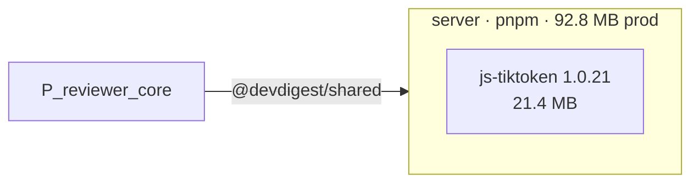

# Report format

The report has **five sections with these names in this order**. The script writes 1-4 as
markdown and a `## 5. Summary` placeholder; you check them, trim noise, fix what it cannot judge,
and write section 5. Do not add other
top-level sections; put anything else under the section it belongs to.

## Contents
- Title line
- 1. Scope
- 2. Dependency graph
- 3. Sizes
- 4. Findings & priorities
- 5. Summary
- Style rules
- Worked example

## Title line

`# Dependency report — <repo>` then one line: packages analysed, declared dependencies, date.

## 1. Scope

A table, one row per package: manager, prod/dev counts, installed yes/no, prod footprint,
total footprint, source files scanned (0 means the scan missed the sources, not a clean package). Under it, **one line per limitation**, because a reader must not mistake a gap
for a clean result:

- `not installed: client, mcp — sizes n/a, peer-dependency and phantom checks unavailable`
- `advisories: not checked (no --audit)` or the counts when run

## 2. Dependency graph

One fenced `mermaid` block from the script (`flowchart LR`, one `subgraph` per package, the
heaviest runtime dependencies plus two dev ones inside, arrows between **packages**). Keep it
one diagram; if it passes about 40 nodes lower `--top`. Rules the script already follows
and you must keep if you edit it [S22]:

- quoted labels (`["next 15.5.19<br/>277 MB"]`), ids made only of letters, digits and `_`;
- no lowercase `end` as an id;
- `-->` alias, `==>` a relative import that crosses packages, dashed red box = unused,
  orange box = heavy.

After the block, one sentence on how to read it, and below it the **internal dependency
table** (from, to, kind alias / vendored / file, via, files). Internal edges are not npm
packages; never merge the two lists.

## 3. Sizes

Fixed subsections, each a table, each sorted by size or severity:

| Subsection | Columns |
|---|---|
| Heaviest dependencies (all packages, top N) | package, dependency, version, section, own, with its deps, only it pulls, status (`used`, `test-only`, `tooling`, `peer-of <dep>`, `unused`; per-package tables add `(src files/test files)`) |
| One table per package | the same, plus declared range; header carries total and prod footprint |
| Duplicated installs | package, dependency, versions, duplicated bytes |
| Version drift between packages | dependency, kind, declared → installed per package |

Always say in one line what the three size columns mean (see [measuring.md](measuring.md)). Do
not round to "about 100 MB" in a table; the script's one decimal is the measured number.

## 4. Findings & priorities

Four tables in this order: **P0**, **P1**, **P2**, **Info**. Columns: `ID | Where | What | Why |
Fix`. An empty tier says `none`, it is not omitted. Rules:

- *Where* is `<package> · <dependency or file:line>`.
- *Fix* is one imperative sentence naming the file: "Move `x` to devDependencies in `server/package.json`".
- Removing or moving a dependency is phrased as a recommendation to confirm.
- Merge repeats (the same rule on the same dependency in five packages is one row listing them).
- Keep the script's `DEP-nn` ids so the Summary can point at them.

## 5. Summary

Three to five actions, **ordered by priority**, each in the shape:

> 1. **<verb + object>** (`DEP-02`, `server/package.json`) — <gain: MB, or what stops breaking>.

Then, at most, one line of context (what was not measured, what to re-run after installing).
No section-by-section recap, no praise, no "overall the repo is healthy".

## Style rules

- A developer reads this once and acts: tables over prose; no sentence that repeats a table row.
- Sizes in MB with one decimal (KB below 1 MB); 1 MB = 1,048,576 bytes, as `du -h` prints it. Say *installed* once at the top of Sizes.
- Name every package by its folder (`server`), every dependency by its npm name, every file
  with a path relative to the repo root.
- Never claim an action was taken. Never invent a size, version or file the script did not print.

## Worked example (cut down)

````markdown
# Dependency report — dev-digest
Packages: 5 · declared dependencies: 95 · 2026-10-12

## 1. Scope
| Package | Manager | Prod | Dev | Installed | Prod footprint | Total footprint |
|---|---|---|---|---|---|---|
| server | pnpm | 23 | 11 | yes | 92.8 MB | 217.0 MB |
| client | pnpm | 11 | 19 | yes | 448.0 MB | 559.2 MB |
Not measured: advisories (no `--audit`).

## 2. Dependency graph


## 3. Sizes
... tables ...

## 4. Findings & priorities
### P1 — fix soon
| ID | Where | What | Why | Fix |
|---|---|---|---|---|
| DEP-02 | server · @fastify/autoload | unused-dependency | no import, script or config references it | Confirm, then remove it from `server/package.json` |

## 5. Summary
1. **Remove `@fastify/autoload`** (`DEP-02`, `server/package.json`) — 171 KB, one fewer package to patch.
````
