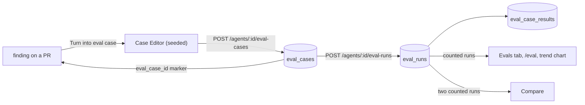
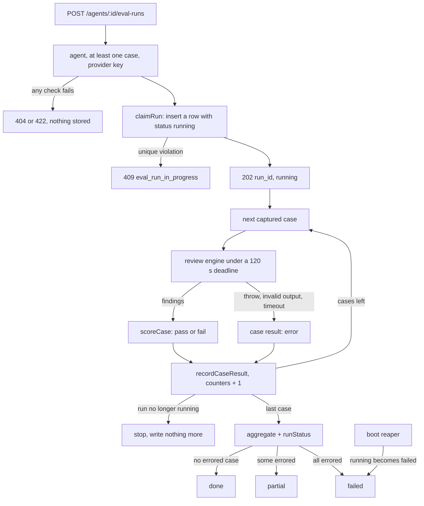

# Eval pipeline: how an agent change gets a number

The eval pipeline tells you whether a change to a review agent made it better or worse.
You turn findings you already accepted or dismissed into eval cases. One click runs the
agent over all its cases in the background, and code (not a model) scores the answers.
Two runs side by side show what moved. This page explains how that works across the
server, the client and the `evals/` harness, and lists the routes, limits and known gaps.
The spec is [`specs/13-eval-pipeline.md`](../specs/13-eval-pipeline.md); the plan is
[`plans/09-eval-pipeline.md`](plans/09-eval-pipeline.md); why the server side is shaped
this way is in [0001](0001-eval-runs-are-their-own-module.md).

## The pieces

| Piece | Where |
|---|---|
| Wire contracts (`EvalCaseSave`, `EvalRunSummary`, `EvalCompare`, finding markers) | `server/src/vendor/shared/contracts/eval-ci.ts`, `review-api.ts` (copied to the client) |
| Routes | `server/src/modules/eval/routes.ts` |
| Use cases: cases, start, runs, compare, dashboard, trend, reaper | `server/src/modules/eval/service.ts` |
| Case rules and the diff preparation a case gets | `server/src/modules/eval/case-rules.ts` |
| Scoring (pure: contracts only, no I/O) | `server/src/modules/eval/scoring.ts` |
| Background run, one case after another | `server/src/modules/eval/run-executor.ts` |
| Persistence: cases, runs, per-case results | `server/src/modules/eval/repository.ts`, `server/src/db/schema/eval.ts` |
| Limits, error codes, fixed texts | `server/src/modules/eval/constants.ts` |
| Public surface of the review rules that eval reuses | `server/src/modules/reviews/index.ts` |
| Finding markers (`eval_case_id`, `eval_unavailable_reason`) | `withEvalMarkers` in `server/src/modules/reviews/helpers.ts` |
| Data hooks (polling while a run is running) | `client/src/lib/hooks/eval.ts` |
| Shared screens: Case Editor, metric cards, runs table, alert, trend chart | `client/src/components/eval/` |
| Finding action "Turn into eval case" | `client/src/app/repos/[repoId]/pulls/[number]/_components/FindingCaseEditor/` |
| Evals tab of an agent | `client/src/app/agents/[id]/_components/AgentEditor/_components/EvalsTab/` |
| `/eval` and `/eval/[agentId]` with Compare | `client/src/app/eval/` |
| Skill eval (stretch) | `evals/skills/spec-authoring/` |

Three tables hold the data. `eval_cases` holds the cases. `eval_runs` holds one row per
run: the agent version, the skill versions, counters and the metrics. `eval_case_results`
holds one row per case per run.

## Data flow



The last edge closes the loop: once a finding has a case, the PR page shows "In eval
set" on its card instead of the button.

## Cases

A case is a frozen input and one expectation. It holds a unified diff, the PR title and
body, and an expectation:

| Field | Meaning |
|---|---|
| `expected_output.type` | `must_find`: a finding must land on the lines. `must_not_flag`: no finding may land there. |
| `expected_output.file`, `start_line`, `end_line` | The location, on the new side of the diff. Bounds are inclusive. |
| `source_finding_id` | The finding the case came from. `null` for a hand-written case. One finding gives at most one case. |

### Seeding a case from a finding

You press **Turn into eval case** on a finding card, in the Findings panel or in the
Files changed tab. Nothing is stored until you press Save. The client builds the seed
from data the PR page already holds (`buildCaseSeed` in
`client/src/components/eval/CaseEditor/helpers.ts`):

- **Type.** A dismissed finding that was not accepted seeds `must_not_flag`. An accepted
  or open finding seeds `must_find`.
- **Name.** `must-find-<slug>` or `no-<slug>`. The slug is the finding title in
  kebab-case, cut to 34 characters, with `finding` as the fallback.
- **Expectation.** The finding's file and line range.
- **Diff.** The stored patch of that file, headed by `--- a/<file>` and `+++ b/<file>`.
- **PR meta.** The PR's title and body as they are now.

In this mode the diff and PR meta are read-only. You edit the name and the expectation.
The editor warns, without blocking, when another case of the agent overlaps the same
lines in the same file.

The server stores what you post. It does not re-derive the seed. For a seeded save it
checks that the finding is in your workspace and that the agent you save for is the
agent that produced the finding.

### When a finding cannot become a case

The server marks every finding on the PR reviews read path. The card shows the marker
and never computes it:

| Marker | Card shows |
|---|---|
| `eval_case_id` set | "In eval set" |
| `eval_unavailable_reason: no_agent` | A disabled button: the review has no agent |
| `eval_unavailable_reason: file_excluded` | A disabled button: the file is one a review never sends to the model (lock files, generated code, migrations) |
| `eval_unavailable_reason: diff_unavailable` | A disabled button: no stored patch, or no hunk of it intersects the finding |
| neither | The enabled button |

The reasons apply in the order of the table. A finding that already seeded a case shows
the case and no reason.

### Save rules

A save, create or edit, must pass the contract and then these rules
(`checkCaseSave` in `case-rules.ts`). A failure answers `422 validation_error` and
`details` names the field.

| Rule | Field in `details` |
|---|---|
| Name is 1 to 120 characters after trimming; diff is 1 to 100,000 characters | `name`, `input_diff` |
| `start_line` is at most `end_line`; both are at least 1 | `expected_output.end_line` |
| The diff has at least one `@@ ... @@` hunk | `input_diff` |
| The expectation's file is not a path a review excludes | `expected_output.file` |
| The expectation's lines intersect a new-side hunk range of that file | `expected_output.start_line` |

An agent holds at most 50 cases. The count and the insert run under a lock on the agent
row, so two concurrent saves cannot both pass the limit.

## Running the set

`POST /agents/:id/eval-runs` answers `202` with a run id before any case finishes. The
work continues in the background of the API process. The client polls the runs list
every 2 seconds while a run is `running`.



### Rules the lifecycle follows

- **Checks come before the claim.** The service answers 404 for an unknown agent, 422
  `eval_no_cases` for an empty set, and 422 `provider_not_configured` (naming the
  provider in `details.provider`) when no API key is stored, all before it inserts a
  row.
- **The claim is one insert.** A partial unique index on `eval_runs (agent_id) WHERE
  status = 'running'` allows one running run per agent. A second start hits the unique
  violation and answers 409 `eval_run_in_progress`. Ten concurrent starts claim one run.
- **Capture happens once.** At claim time the service freezes the agent's prompt, model,
  strategy and version, the skills that apply to the cases with their versions, and the
  case ids. The run never re-reads the agent, so an edit during the run does not change
  it. The run row stores `agent_version`, `skill_versions` and `case_ids`.
- **Cases run sequentially.** One case finishes before the next starts.
- **Same engine, same preparation as a PR review.** Each case goes through the same
  `reviewPullRequest` engine, the same `excludeFromReview` filter, the same skill
  applicability rule and the same review-rules text as a pull request. The case gets
  nothing else: no intent, scope, callers, repo map, project context or memory. The
  engine gets the diff, the PR title and body, a task line
  (`Review pull request. <review rules>`), the captured prompt, model and
  strategy, and the applied skill blocks. The title is the first line of the PR
  description block (`Title: <title>`, one line, cut to 200 characters), so it is fenced
  as untrusted data with the body; the task line holds no PR-author text.
- **Case diffs are normalised first.** A typed or seeded diff has `---`/`+++` headers
  but no `diff --git` line, and the review filter keys on that line.
  `normalizeCaseDiff` adds it, so generated and fixture files are removed as in a
  review.
- **One request per case, 120 s.** The executor wraps the provider so every structured
  call gets `maxRetries: 0`, `transportRetries: 0` and a 120 s request timeout, and it
  races the whole case against the same 120 s deadline. A wrong shape is never
  re-prompted. This holds one request for a `single-pass` agent. An agent whose
  strategy is `map-reduce` (or `auto` on a large diff) sends one request per file.
- **A case fails alone.** A throw, an invalid output or a timeout stores that case as
  `error` and the run goes on. The result never stores a provider's message.
- **Progress is written as it happens.** Each case result and the run counters change
  in one transaction guarded by `status = 'running'`. A run that was reaped or ended
  under the executor stops writing.
- **A store failure still ends the run.** The executor marks the run `failed`, so the
  agent's claim is released and the next start is not a 409.
- **Boot reaper.** A run executes inside the process that started it. When the API
  starts, `buildApp` marks every `running` row as `failed` before it listens, next to
  the review and onboarding reapers in `server/src/app.ts`. A failure there is logged
  and is not fatal.
- **No agent flag check.** A disabled agent can still run.

### Run status

| Status | When | Counted |
|---|---|---|
| `running` | Claimed, cases still going | No |
| `done` | Every case completed (pass or fail), none errored | Yes |
| `partial` | At least one case completed and at least one errored | Yes |
| `failed` | Every case errored, the store failed, or the reaper ended it | No |

A **counted run** is `done` or `partial`. Only counted runs feed a case's latest
outcome, the metric cards, the deltas, the regression alert, the dashboard rows, the
trend chart and Compare. A `running` or `failed` run shows in the runs table with a
badge and nowhere else.

## Scoring

Scoring is code. `scoring.ts` imports contracts only and makes no model call.

### Matching one case

A kept finding matches an expectation when the file is equal and the line ranges
intersect, with inclusive bounds and no slack. Kept means the finding survived the
engine's grounding gate, which drops a finding whose file is not in the diff or whose
lines do not intersect a diff hunk.

| Expectation | Case passes when | `expected_count` |
|---|---|---|
| `must_find` | at least one kept finding matches | 1 |
| `must_not_flag` | no kept finding matches | 0 |

A case that errored has no outcome. It counts in `cases_errored` and feeds no metric.

### Metrics of a run

All metrics use the completed (non-errored) cases only.

| Metric | Definition | `null` when |
|---|---|---|
| `recall` | passed `must_find` cases ÷ completed `must_find` cases | no completed `must_find` case |
| `precision` | TP ÷ (TP + FP), per finding: TP is a kept finding that matches a `must_find` expectation, FP is a kept finding that matches a `must_not_flag` expectation | TP + FP is 0 |
| `citation_accuracy` | kept ÷ (kept + dropped) over every completed case | no finding at all |
| `unlabelled_findings` | kept findings that match no expectation, summed (never `null`) | — |
| `cost_usd` | sum of the completed cases' costs | no completed case, or one has no price |

Precision looks only at the locations you labelled. A finding somewhere else is not a
false positive. It counts in `unlabelled_findings`, so a run with a high precision and
a high unlabelled count tells you the agent also says things nobody has judged.

A metric that is `null` shows as `—`, never as `0%`. Cards and tables show metrics as
whole percentages.

### The regression alert

The client compares the latest and the previous counted run. It rounds both values to
whole percentages and names every metric that fell by at least one point. A metric
that is `null` on either side is skipped.

## Compare, dashboard and trend

`GET /eval-runs/compare?a=&b=` takes two counted runs of one agent and returns them
oldest first:

- **Sides.** Each side is the run plus the system prompt and model that its agent
  version held, read from the version snapshot. Either is `null` when that snapshot is
  gone.
- **Flipped cases.** A case that passed in one run and failed in the other, with its
  direction. A case that errored in either run, or that no longer exists, is not listed.
- **Case sets.** `case_sets_differ`, `only_in_older` and `only_in_newer` count the
  cases that only one run had, so you know the metrics are not over the same set.

The Compare modal also shows a word diff of the two prompts and the skills whose
version changed, were added or were removed. The diff is computed on the client and
renders as text.

`GET /eval/dashboard` returns every agent of the workspace with its latest counted run
(or `null`), plus the 6 newest counted runs across agents. `GET
/agents/:id/eval-trend` returns every counted run of the agent, oldest first, for the
trend chart.

## Routes

All routes are workspace-scoped. An id from another workspace answers 404.

| Route | Success | Errors |
|---|---|---|
| `GET /agents/:id/eval-cases` | 200 `{ cases }`, each with its latest counted outcome (`pass`, `fail`, `error`, `never_run`) | 404 `not_found` |
| `POST /agents/:id/eval-cases` | 201 case | 404 `not_found` (agent, or finding); 422 `finding_agent_mismatch`; 422 `validation_error`; 422 `eval_case_limit`; 409 `eval_case_exists` |
| `PUT /eval-cases/:id` | 200 case, same id and source finding (`source_finding_id` in the body is ignored) | 404 `not_found`; 422 `validation_error` |
| `DELETE /eval-cases/:id` | 204; past runs keep their metrics | 404 `not_found`; 409 `eval_run_in_progress` |
| `POST /agents/:id/eval-runs` | 202 `{ run_id, status: "running" }`; 10 per minute | 404 `not_found`; 422 `eval_no_cases`; 422 `provider_not_configured`; 409 `eval_run_in_progress`; 429 |
| `GET /agents/:id/eval-runs?limit=` | 200 `{ runs, latest_counted, previous_counted }`; `limit` 1 to 50, default 10 | 404 `not_found`; 422 `validation_error` |
| `GET /agents/:id/eval-trend` | 200 `{ points }` | 404 `not_found` |
| `GET /eval-runs/compare?a=&b=` | 200 `EvalCompare` | 404 `not_found`; 422 `validation_error` (same run twice); 422 `eval_runs_of_different_agents`; 422 `eval_run_not_counted` |
| `GET /eval/dashboard` | 200 `{ agents, recent_runs }` | none |

Errors use the standard envelope `{ error: { code, message, details } }`. The messages
are fixed texts in `server/src/modules/eval/constants.ts`.

## Limits

| Limit | Value |
|---|---|
| Cases per agent | 50 |
| Case name, diff | 120 and 100,000 characters |
| Time per case | 120 s |
| Run starts | 10 per minute |
| Running runs per agent | 1 |
| Runs list | default 10, at most 50 |
| Findings kept in one case result | 200, each title cut to 200 characters |
| PR title in the fenced PR description | one line, cut to 200 characters |

## Where you see it

| Surface | What it shows |
|---|---|
| Finding card on the PR page | **Turn into eval case**, "In eval set", or the reason the action is off. Opens the Case Editor in seeded mode. While the editor is open, the panel ignores its finding shortcuts. |
| Agent page, **Evals** tab (`/agents/:id?tab=evals`) | Regression alert, metric cards with the change in points and "Traces passed", the trend chart, the case list with each case's latest outcome ("expected N, got M"), **New eval case**, edit and delete, **Run all evals** with `k / n cases` while running, the last 10 runs, and a link to the full dashboard |
| `/eval` (sidebar **Eval Dashboard**, under Skills Lab) | Every agent with its latest counted run or "No eval runs yet", and the 6 newest counted runs |
| `/eval/[agentId]` | Alert, cards, trend, **Run eval**, and up to 50 runs. Select two counted runs and press **Compare** |

The sidebar label lives in the `eval` message namespace, not in `nav.ts`.

## Checking the pipeline

### `pnpm verify:l06`

Run it from `server/`. It chains `pnpm typecheck`, `pnpm lint` and the unit tests whose
path contains `test/eval-`. It needs no Docker, no network and no API key. The check
itself is `server/test/eval-verify-l06.test.ts`: it runs the real `EvalRunExecutor` and
`scoring.ts` over a case set that yields every metric, with a canned model and an
in-memory store. It is not part of CI, and it does not run the `.it.test.ts` file that
covers the claim and the routes (`pnpm test:integration`, needs Docker).

### The skill eval

`evals/skills/spec-authoring/` holds four cases for the `spec-authoring` skill, in the
same harness as the other skills. Each case checks concrete strings that come from a
rule in the skill (EARS keywords, `AC-`/`EC-`/`OQ-` ids, provenance tags,
`Status: draft`, `Amended:`) before a judge reads the practices. Run it from `evals/`:

```sh
pnpm eval:repeat skills/spec-authoring -n 2
```

## Known limits

- **No cancel.** A run goes on until it ends. There is no route to stop it, and the only
  early end is a restart of the API, which marks it `failed`.
- **The PR title is data, not instruction.** The case's PR title and body go into the
  engine's `prDescription` slot (`Title: <title>` first), inside an `<untrusted>` block,
  and the task line carries no author text. This differs from a real review, where
  `taskLine` still puts the PR title in the unfenced task line.
- **A case deleted between the case read and the claim fails the run.** Delete is
  refused while a run is `running`, but not before the claim. If a case disappears in
  that gap, the run still reviews its captured copy, then fails to store that case's
  result and ends `failed` with no metrics.
- **A run belongs to the API process that started it.** The boot reaper ends every
  `running` row, not only the rows of its own process. A second API instance that
  starts would fail the runs of the first.
- **One request per case is for `single-pass`.** See the lifecycle rules above.
- **Cases run one by one.** A set of 50 slow cases can take many minutes.
