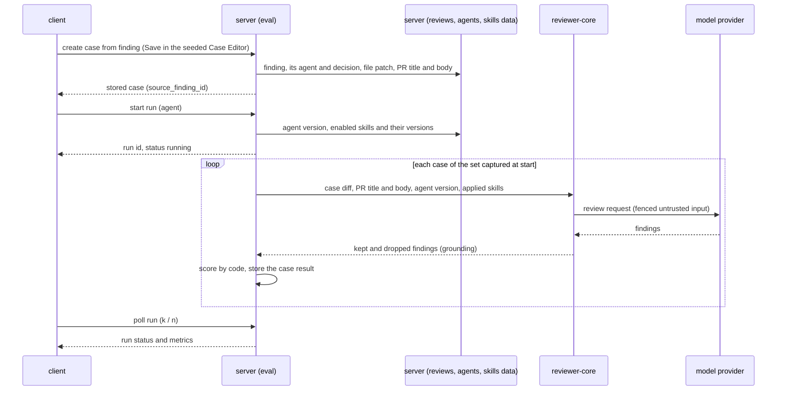

# Spec: Eval Pipeline
Spec ID: SPEC-13
Status: implemented
Supersedes: none
Packages: server, client, evals (stretch c only)
Sources: user brief (course homework L06 "Eval Pipeline", hw/L06/hw6-task.md; the course checklist names this file `specs/eval-pipeline.md`, kept here under the repo's `NN-name.md` convention) · design files in client/docs/design (artboards `agent-evals`, `evalcase`, `pr-overview`, `pr-files`, `agent-perf`; the Eval Dashboard in screen_skills; findings, components2, data2) · existing eval tables and contracts (eval_cases, eval_runs, EvalCase, EvalRun, EvalDashboard) · specs/03-skills.md · specs/01-run-cost-badge.md · user decisions of 2026-10-14 (16 points) · user answers to the discovery questions (Q1–Q12 option 1 each; proposals P1, P2, P3 and defaults D1–D6 accepted)
Amended: 2026-10-14 — AC-1, AC-8, AC-51, EC-2 reworded; AC-63, AC-64, AC-65, EC-20 added (brainstorm, docs/plans/09-eval-pipeline.brainstorm.md open questions 3 and 5); AC-66 added, AC-16, AC-37, AC-40, AC-42, AC-58 reworded to cite it (implementation-planner, requirements review question 1)

## Problem and user
A developer who tunes a DevDigest review agent changes its system prompt, its model or one of its
linked skills, and then has no way to tell whether the agent got better or worse. Today the only
check is to re-run reviews on a few pull requests and read the findings by eye. That check is slow,
costs a full review each time, and its result depends on which pull requests were picked and what
the reader remembers. Meanwhile the product already holds a labelled dataset that nobody uses for
this: every finding the developer accepted (the agent should find it) or dismissed (the agent
should stay quiet there) since lesson L01. Nothing turns those decisions into repeatable test
cases, runs an agent version on them, or puts two versions side by side in numbers.

## Goals / Non-goals
**Goals**
- A finding on the pull-request page becomes an eval case of its agent in one click plus Save. An accepted or open finding gives a `must_find` case and a dismissed one gives a `must_not_flag` case.
- One action runs an agent on every case of its set, using only inputs fixed in the case and the agent version captured at start, so two runs of different versions are comparable.
- Code alone computes each run's recall, precision and citation_accuracy, with no model call. A metric that cannot be computed reads `—`.
- The Evals tab of the Agent Editor and a new Eval Dashboard page show the case set, the latest metrics with their change, and the run history.
- Two runs of one agent can be compared side by side, with the metric deltas, the system-prompt diff, the version changes and the cases that flipped.
- A system-prompt change visibly moves recall or precision between two runs on a set of at least 8 cases.
- `pnpm verify:l06` in the server package is green.

**Non-goals**
- "Run all agents" on the dashboard — declined by the user. Runs are started per agent.
- The "30 days" filter on the dashboard agent page — declined by the user.
- "Promote vN" in the compare view — declined by the user. Agent versions are managed in the Agent Editor.
- Running a single case ("Run case") and "Run on save" in the Case Editor — declined by the user. A run always covers the whole set.
- The Case Editor's "Files" tab and "Finding skeleton" button — declined by the user. The case diff is the only code input.
- A free-form JSON "Expected output" pane — replaced by the structured expectation fields (type, file, start_line, end_line). One expectation per case is enough to score by code.
- Eval cases owned by a skill (the Skills Lab "Evals" tab, "Run on evals") — this homework covers agents only. specs/03-skills.md already defers it.
- Counting eval runs as ordinary agent runs (pull-request run history, agent cost totals, Agent Performance) — the user chose to keep production statistics clean. An eval run's cost is shown on the eval run only.
- Cancelling a running eval — in neither the design nor the brief.
- Intent, scope filter, repository map, callers, memory or project context in an eval run's prompt — the user fixed the inputs to the case snapshot and the agent version. These inputs change over time and would make runs incomparable.
- A line slack in matching, or a model judge in scoring — the user chose strict range intersection and scoring by code only.
- The PreToolUse hook and mutation-testing stretch tasks — out by the user's decision.
- The screenshot and the demo video of the hand-in — hand-in items, not product behaviour.

## User stories
- US-1: As a developer reviewing a pull request, I want to turn a finding into an eval case of its agent from the finding card, so that my accept and dismiss decisions become regression tests.
- US-2: As an agent author, I want to see every case of an agent's set with its last outcome, so that I know what the agent is tested on and where it fails.
- US-3: As an agent author, I want to run the agent on all cases of its set in one action, so that I can check a prompt, model or skill change before relying on it.
- US-4: As an agent author, I want recall, precision and citation_accuracy computed by code for every run, so that the numbers are cheap, repeatable and free of model judgement.
- US-5: As an agent author, I want the run history with each run's change against the previous one and an alert on a drop, so that I notice a regression at once.
- US-6: As an agent author, I want to compare two runs side by side, so that I see what changed between the old and the new prompt and which cases flipped.
- US-7: As an agent author, I want an Eval Dashboard page that lists every agent's latest eval, so that I can watch all agents from one place.
- US-8: As a course participant, I want one command that checks the eval feature, so that I can show it is green before handing in.
- US-9: As an agent author, I want to create a case from a pasted diff, edit a case and delete one, so that the set is not limited to existing findings.
- US-10: As an agent author, I want a trend chart of the three metrics over all runs, so that I see the direction across many versions.
- US-11: As a course participant, I want an eval of the `spec-authoring` skill in the evals harness, so that a broken skill shows up as a failing case.

## Workflow and module interactions

What crosses the boundaries (wire spelling, server → client unless stated). These are the
existing EvalCase / EvalRun / EvalDashboard contracts plus their extensions.
- **Eval case**: `id`, `owner_kind` (`agent`), `owner_id`, `name`, `input_diff`, `input_meta` (`pr_title`, `pr_body`), `expected_output` (`type` = `must_find` | `must_not_flag`, `file`, `start_line`, `end_line`), `source_finding_id` (nullable), `notes`, plus the case's latest outcome (`pass` | `fail` | `error` | `never_run`, `expected_count`, `matched_count`).
- **Case save request** (client → server): `name`, `input_diff`, `input_meta`, `expected_output`, `source_finding_id` (seeded cases only).
- **Eval run** (run-level record): `id`, `agent_id`, `agent_version`, `skill_versions[]` (`skill_id`, `name`, `version`, the skills actually applied), `status` (`running` | `done` | `partial` | `failed`), `started_at`, `finished_at`, `cases_total`, `cases_completed`, `cases_errored`, `cases_passed`, `recall`, `precision`, `citation_accuracy` (each nullable), `unlabelled_findings`, `cost_usd` (nullable).
- **Case result** (one per case per run): `case_id`, `status` (`pass` | `fail` | `error`), `expected_count`, `matched_count`, `kept`, `dropped`, `findings[]` (`file`, `start_line`, `end_line`, `title`), `duration_ms`, `cost_usd` (nullable).
- **Compare**: the two runs, their system prompts, models and skill versions, `flipped[]` (`case_id`, `name`, `from`, `to`), `case_sets_differ`.
- **Finding** (existing finding payload): gains `eval_case_id` (nullable) and the reason the action is unavailable, if any.
- Run start is `POST /agents/:id/eval-runs`, as named by the course.

## Acceptance criteria (EARS)
### Creating a case from a finding
- AC-1 (US-1): WHILE a finding has an agent, its file is not excluded from review (AC-65), and its [start_line, end_line] range intersects the new-side range of a hunk in the stored patch of its file (bounds inclusive, the rule grounding uses), the finding card shall show an enabled "Turn into eval case" action whatever the finding's decision (open, accepted or dismissed).
- AC-2 (US-1): WHEN the user clicks "Turn into eval case", the client shall open the Case Editor seeded from the finding without storing any case.
- AC-3 (US-1): WHEN the Case Editor is seeded from a finding, the Case Editor shall preselect the expectation type `must_find` for an accepted or open finding, else `must_not_flag` for a dismissed one.
- AC-4 (US-1): WHEN the Case Editor is seeded from a finding, the Case Editor shall pre-fill the name as `must-find-<slug>` (`must_find`) or `no-<slug>` (`must_not_flag`) with the finding's file, start_line and end_line, where `<slug>` is the finding title in lower-case kebab-case cut to 34 characters, or `finding` when that is empty.
- AC-5 (US-1): WHEN the Case Editor is seeded from a finding, the Case Editor shall show, as a read-only diff preview, the stored patch of the finding's file headed by `--- a/<file>` and `+++ b/<file>`.
- AC-6 (US-1): WHEN the Case Editor is seeded from a finding, the Case Editor shall show the pull request's title and body read-only in a "PR meta" tab.
- AC-7 (US-1): WHEN the user saves a seeded case, the server shall store a case holding the source finding id, the diff shown, the pull request's title and body as they are at that moment, the name and the expectation.
- AC-8 (US-1): IF a finding has no agent, or no hunk's new-side range in the stored patch of its file intersects its line range, THEN the finding card shall show "Turn into eval case" disabled with the reason "This finding has no agent" or "The diff of this finding is no longer available" respectively.
- AC-9 (US-1): WHILE a finding is the source of an existing case, the finding card shall show the label "In eval set" in place of the action.
- AC-10 (US-1): IF a request would create a second case from the same finding, THEN the server shall reject it with status 409.
- AC-11 (US-1, US-9): IF a saved case has a name outside 1–120 characters, a diff over 100 000 characters or with no unified-diff hunk, a start_line greater than its end_line, or a range that intersects no hunk of the case diff for that file, THEN the server shall reject the save with status 422 naming the failing field.
- AC-12 (US-1, US-9): IF the agent already has 50 cases, THEN the server shall reject a new case with a message stating the limit of 50 cases per agent.
- AC-13 (US-1, US-9): WHILE the expectation in the Case Editor intersects the expectation of another case of the same agent in the same file, the Case Editor shall show a non-blocking warning naming that case.
- AC-14 (US-2): WHEN an agent is deleted, the server shall delete the agent's cases with their runs.
- AC-63 (US-1): IF the file of a seeded case matches the generated and fixture files that a pull-request review excludes (AC-21), THEN the server shall reject the save with status 422 and the message "This file is excluded from review and can never pass preparation".
- AC-65 (US-1): IF a finding's file matches the generated and fixture files that a pull-request review excludes (AC-21), THEN the finding card shall show "Turn into eval case" disabled with the reason "This file is excluded from review".

### The case set
- AC-15 (US-2): WHEN the user opens the Evals tab of an agent, the client shall list every case of the agent's set with its name, its expectation-type badge and a badge with the case count.
- AC-16 (US-2): The Evals tab shall show on each case row the case's outcome in the latest counted run (AC-66) that included it, as `pass`, `fail`, `error` or `never run`, with the text "expected N, got M" (N = 1 for `must_find`, 0 for `must_not_flag`; M = kept findings matching its expectation).
- AC-17 (US-3): IF an agent has no case, THEN the Evals tab shall show its Run action disabled with the reason "Add a case first".

### Running the set
- AC-18 (US-3): WHEN the user clicks "Run all evals" on the Evals tab or "Run eval" on the dashboard agent page, the server shall answer with the new run's id and the status `running` before any case completes.
- AC-19 (US-3, US-6): WHEN a run starts, the server shall store with the run the agent version, the version of each skill it applies, and the ids of the cases that exist at that moment.
- AC-20 (US-3): The server shall not send the agent any pull-request input other than the case diff and the case's pull-request title and body.
- AC-21 (US-3): WHEN a case is run, the server shall apply the same deterministic pre-processing as a pull-request review (generated and fixture files excluded, skills filtered by their file globs against the case's files).
- AC-22 (US-3): WHILE a run of the agent is running, the Evals tab shall show its progress as `k / n cases`, refreshed every 2 s (OQ-1).
- AC-23 (US-3): IF a run of the same agent is already running, THEN the server shall reject a new start with status 409.
- AC-24 (US-3): IF the agent's model provider has no API key configured, THEN the server shall reject the start with a 4xx error naming the provider, without creating a run.
- AC-25 (US-3): IF the agent has no case, THEN the server shall reject the start with status 422.
- AC-26 (US-3): IF one case fails (provider error, invalid model output, time-out), THEN the server shall record that case as `error` and go on with the next case.
- AC-27 (US-3): WHEN every case of a run has finished, the server shall set the run status to `done` when no case is `error`, `partial` when at least one case completed and at least one is `error`, or `failed` when no case completed.
- AC-28 (US-3): WHEN the server starts, the server shall set every eval run still in the status `running` to `failed`.
- AC-66 (US-2, US-4, US-5, US-7, US-10): The system shall treat an eval run as a counted run only when its status is `done` or `partial`, so that a `running` or `failed` run never sets a case outcome, a metric card, a delta, a regression alert, a dashboard row or a trend point.

### Scoring
- AC-29 (US-4): The server shall count a kept finding as matching an expectation when the finding's file, after grounding's path resolution, equals the expectation's file and its [start_line, end_line] range intersects the expectation's range (bounds inclusive, no slack).
- AC-30 (US-4): WHEN a case completes, the server shall mark a `must_find` case `pass` when at least one kept finding matches its expectation, or a `must_not_flag` case `pass` when no kept finding matches it, else `fail`.
- AC-31 (US-4): The server shall compute a run's recall as passed `must_find` cases divided by completed `must_find` cases.
- AC-32 (US-4): The server shall compute a run's precision as TP / (TP + FP) over completed cases, where TP counts kept findings matching a `must_find` expectation of their case and FP counts kept findings matching a `must_not_flag` expectation of their case.
- AC-33 (US-4): The server shall compute a run's citation_accuracy as kept findings divided by kept plus grounding-dropped findings over completed cases.
- AC-34 (US-4): IF a metric's denominator is 0, THEN the server shall store the metric as null, which the client shows as `—`.
- AC-35 (US-4): The server shall store per run the count of kept findings that match no expectation as `unlabelled_findings`, outside every metric.
- AC-36 (US-4): The server shall store a run's cost as the sum of its completed cases' costs when each of them has a cost, else as null, which the client shows as `—`.

### Evals tab: metrics and history
- AC-37 (US-4, US-5): WHEN the Evals tab opens, the client shall show recall, precision and citation_accuracy of the agent's latest counted run (AC-66) as whole percentages, each with its change in whole points (▲ or ▼) against the previous counted run, plus "Traces passed" as passed / completed cases.
- AC-38 (US-5): WHEN the Evals tab opens, the client shall list the agent's latest 10 runs newest first, each row showing time, agent version, recall, precision, citation_accuracy, passed / completed cases, errored cases, unlabelled findings, cost, and a `running`, `partial` or `failed` badge when that applies.
- AC-39 (US-5): WHEN the user clicks "View full dashboard →" on the Evals tab, the client shall open the Eval Dashboard on that agent's page.
- AC-40 (US-5): WHEN the latest counted run (AC-66) of an agent is lower than the previous counted run by at least 1 whole point on recall, precision or citation_accuracy, the client shall show a regression alert on the Evals tab and on the dashboard agent page that names each dropped metric with its drop in points.

### Eval Dashboard and compare
- AC-41 (US-7): The client shall show an "Eval Dashboard" item in the SKILLS LAB section of the sidebar, right after Conventions.
- AC-42 (US-7): WHEN the user opens the Eval Dashboard, the client shall list every agent of the workspace with its latest counted run's (AC-66) agent version, time, passed / completed cases, recall, precision and citation_accuracy, or "No eval runs yet".
- AC-43 (US-7): WHEN the user opens the Eval Dashboard, the client shall show the 6 newest eval runs across all agents with agent name, time, agent version, the three metrics and passed / completed cases.
- AC-44 (US-5, US-7): WHEN the user opens an agent on the Eval Dashboard, the client shall show the agent's metric cards (as in AC-37) above a runs table of at most 50 runs, newest first.
- AC-45 (US-6): WHILE exactly two runs whose status is `done` or `partial` are selected in the runs table, the client shall enable the "Compare" action.
- AC-46 (US-6): WHEN the user opens Compare, the client shall show, for recall, precision, citation_accuracy and cost, the older run's value, the newer run's value and the change between them.
- AC-47 (US-6): WHEN the user opens Compare, the client shall show a word-level diff of the two runs' system prompts, marking removed and added words.
- AC-48 (US-6): WHEN the user opens Compare, the client shall show a version summary listing both agent versions, the model of each run, and each skill whose version differs, was added or was removed between the runs.
- AC-49 (US-6): WHEN the user opens Compare, the client shall list each case present in both runs whose outcome changed between `pass` and `fail`, with its direction.
- AC-50 (US-6): IF the two compared runs evaluated different case sets, THEN the compare view shall show the banner "Case sets differ" with the number of cases only in the older run and only in the newer run.

### Checking the feature
- AC-51 (US-8): WHEN `pnpm verify:l06` runs in the server package, the verify command shall exit with status 0 only if typecheck, lint, the eval module's unit tests (no database) and a scoring check that computes every metric with no model provider available all pass.

### Stretch (a): New, edit and delete cases — cuttable
- AC-52 (US-9): WHEN the user clicks "New eval case" on the Evals tab, the client shall open an empty Case Editor whose diff, pull-request title, pull-request body, name and expectation fields are editable.
- AC-53 (US-9): WHEN the user pastes a diff into the Case Editor, the Case Editor shall show it as a diff preview with added and removed lines marked.
- AC-54 (US-9): WHEN the user saves an existing case after editing it, the server shall store the new values under the same case id with its source finding id unchanged.
- AC-55 (US-9): WHEN the user deletes a case, the client shall ask for confirmation naming the case before sending the delete.
- AC-56 (US-9): WHEN a case is deleted, the server shall keep the stored run-level metrics of past runs unchanged.
- AC-57 (US-9): IF a case is deleted while a run of its agent is running, THEN the server shall reject the delete with status 409.
- AC-64 (US-9): IF the expectation's file of a case created or edited in the Case Editor matches the generated and fixture files that a pull-request review excludes (AC-21), THEN the server shall reject the save with status 422 and the message "This file is excluded from review and can never pass preparation".

### Stretch (b): Trend charts — cuttable
- AC-58 (US-10): WHEN the Evals tab or the dashboard agent page opens, the client shall show one chart with recall, precision and citation_accuracy as three lines, one point per counted run (AC-66) in chronological order.
- AC-59 (US-10): WHEN the user hovers or focuses a chart point, the client shall show that run's agent version with its cost.

### Stretch (c): Eval of the spec-authoring skill — cuttable
- AC-60 (US-11): The evals harness shall hold 3 to 4 cases for the `spec-authoring` skill, each checking concrete facts by pattern match before any judged practice.
- AC-61 (US-11): WHEN the harness runs those cases against the current `spec-authoring` skill, the evals harness shall report every one of those cases as passed.
- AC-62 (US-11): IF a rule the cases check is removed from the `spec-authoring` skill, THEN the evals harness shall report at least one of those cases as failed.

## Edge cases
- EC-1: a finding produced by a built-in detector with no agent → the action is disabled with "This finding has no agent" (AC-8)
- EC-2: the pull request was re-imported with a new head and no hunk's new-side range in the stored patch intersects the finding's range any more → the action is disabled with "The diff of this finding is no longer available" (AC-8)
- EC-3: the source finding's decision changes after its case exists → the case keeps its stored expectation, and the finding keeps showing "In eval set" (AC-7, AC-9)
- EC-4: the user clicks Save twice, or two tabs save a case from one finding → one case is stored, the second request gets 409 (AC-10)
- EC-5: a finding title longer than 34 characters, or one that leaves an empty slug → the seeded name uses the first 34 slug characters, or `finding` (AC-4)
- EC-6: the agent is edited while a run is running → the run keeps the agent version captured at its start (AC-19)
- EC-7: a linked skill's body is edited without changing the agent version → the next run records the new skill version, and Compare lists the change (AC-19, AC-48)
- EC-8: a case is created while a run of its agent is running → it is not part of that run and shows `never run` until a later run (AC-19, AC-16)
- EC-9: two browser tabs start a run of the same agent → the second start gets 409 (AC-23)
- EC-10: the model returns output that fails validation for one case → that case is `error`, the others still run, the run ends `partial` (AC-26, AC-27)
- EC-11: every case of a run ends in `error` → the run is `failed`, its metrics show `—`, and it cannot be selected for Compare (AC-27, AC-45)
- EC-12: the set holds only `must_not_flag` cases → recall shows `—` (AC-34)
- EC-13: no kept finding lands on any labelled location → precision shows `—`, and the findings count as unlabelled (AC-34, AC-35)
- EC-14: the model cites only the file name of a diff file that sits in a sub-folder, and grounding resolves it to the diff's full path → the finding matches an expectation on that full path (AC-29)
- EC-15: a full-file finding kind (secret_leak, lethal_trifecta) is kept by grounding whatever its lines → it matches only if its own range intersects the expectation's range (AC-29)
- EC-16: one completed case reports no cost → the run's cost shows `—` (AC-36)
- EC-17: the agent is disabled for pull-request reviews → its eval runs still start (AC-18)
- EC-18: the API restarts during a run → the run shows `failed` after the restart (AC-28)
- EC-19: a case that two compared runs both evaluated is deleted later → it no longer appears among flipped cases, while both runs keep their metrics (AC-49, AC-56)
- EC-20: a finding on a generated or fixture file (a lock file, a snapshot) → the action is disabled with "This file is excluded from review", and a save request for such a file, seeded or written by hand, gets 422 with "This file is excluded from review and can never pass preparation" (AC-65, AC-63, AC-64)

## Non-functional requirements
- NFR-1: Scoring makes zero model calls. Every metric of AC-29 to AC-36 is computed with no model provider configured, as `pnpm verify:l06` checks (AC-51).
- NFR-2: Cost — a run invokes the review engine once per case (one model call under the single-pass strategy, one per changed file under map-reduce). It makes no other model call: no intent derivation, no judge.
- NFR-3: Security — run start is limited to 10 requests per minute per client, like review start, and the 11th gets status 429.
- NFR-4: Security — every eval request is scoped to the caller's workspace. A case, run or agent of another workspace answers 404.
- NFR-5: i18n — every new UI text lives in the eval message namespace, and no text is hard-coded in components.
- NFR-6: Accessibility — every new action (Turn into eval case, run selection, Compare, Run, Save, Cancel, delete confirmation) is reachable and operable by keyboard. The Case Editor and the compare view close with Escape and return focus to the element that opened them.

## Inputs and provenance
| Input | Provenance | Notes |
|---|---|---|
| Finding location, title, decision and agent | [reused: L01 findings with accept/dismiss] | The dataset the brief names. No new labelling |
| Case diff (whole stored patch of the finding's file) | [reused: pull-request files stored at import] | Headers added. Capped at 100 000 characters |
| Pull-request title and body | [reused: pull request record] | Snapshot at case creation |
| Agent configuration at run start | [reused: agent version snapshots] | System prompt, provider, model, strategy, enabled skills |
| Skill versions at run start | [reused: skill versions] | Only the skills applied after the file-glob filter |
| Generated/fixture exclusion and skill applicability | [deterministic: reviews pre-processing] | The same rules as a pull-request review (AC-21) |
| Agent findings per case | [new: 1 LLM call] | One per case (more under map-reduce). Running the agent is what is measured, so no stored result can stand in for it |
| Kept and dropped findings | [deterministic: reviewer-core grounding] | Feeds citation_accuracy and matching |
| Pass, recall, precision, citation_accuracy, unlabelled count | [deterministic: eval scoring] | No model call (NFR-1) |
| Prompt diff, version summary, flipped cases, regression alert | [deterministic: eval module] | Computed from the stored runs |
| Case and run cost | [reused: provider-reported cost of each case's call] | `—` when unknown |

## Untrusted inputs
| Input | Who controls it | Where it goes | Required handling |
|---|---|---|---|
| Case diff (seeded or pasted) | The pull-request author, or whoever wrote the pasted text | Model prompt, Case Editor preview, database | Fenced in the prompt as untrusted data under the existing injection guard. Rendered as text, never as HTML. Length-checked (AC-11) |
| Pull-request title and body in a case | The pull-request author | Model prompt, "PR meta" tab | Fenced in the prompt as untrusted data. Rendered as text |
| Finding title seeding the case name | Model output, steerable by the pull-request author | Case name in the editor, lists and dashboard | Rendered as text. Length-checked (AC-11) |
| Findings returned in an eval run (file, lines, title) | Model output | Stored case results, scoring, UI | Validated against the findings schema before storage. Rendered as text. Line ranges of any size cost no more to score than the diff's own lines |
| System prompts shown in Compare | Workspace users | Compare view | Rendered as text, never as HTML or markdown with raw HTML |
| HTTP requests to the eval endpoints | Any page open in the user's browser | Case create/edit/delete, run start | Bodies validated against the contracts. Workspace-scoped (NFR-4). Run start rate-limited (NFR-3) |

## Open questions
- OQ-1: How often does the client refresh a running run's progress? — default if unanswered: every 2 s while the Evals tab or the dashboard agent page is open.
