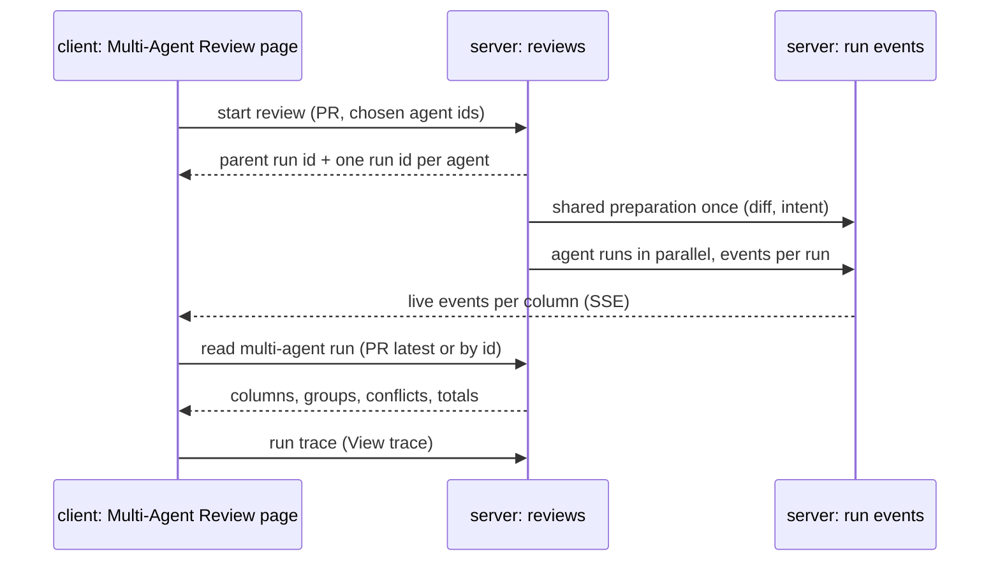

# Spec: Multi-Agent Review
Spec ID: SPEC-14
Status: implemented
Supersedes: none
Packages: server, client
Sources: user brief (GoIT L07 lab "Part 2 — Multi-Agent Review and live statuses" plus the user's extra instructions, relayed 2026-10-17) · user answers to the discovery questions (2026-10-17) · client/docs/design/artboards.md (N4 `ma-cols`, `ma-tabs`, `e-ma`) · client/docs/design/src/screen_multiagent.jsx · client/docs/design/src/components2.jsx (Run Review picker) · current code of the reviews module, the run trace drawer and the live log · specs/07-flutter-first-review.md · specs/13-eval-pipeline.md

## Problem and user
A developer reviewing a pull request can run several specialised agents on it (security,
performance, domain rules), but the product shows their results one run at a time on the PR
page. To compare agents the developer opens each run, reads the findings, and works out by hand
which agents flagged the same lines and which stayed silent. The developer cannot pick a subset
of agents for one review: the PR page offers one agent or every enabled agent. While a
several-agent review runs, every agent looks "running" although the agents are run one after
another. So the developer can tell neither how far the review is nor what the extra agents cost
compared with a single one.

## Goals / Non-goals
**Goals**
- The developer starts one review of a pull request with a chosen set of agents and sees an
  estimate of its time and cost before starting it.
- During the review the developer sees each agent's own state, and one failed agent never hides
  the results of the others.
- The developer compares the agents side by side. Findings that point at the same lines appear
  as one group, and every original finding keeps its author and its text.
- The developer sees, for each group, what every agent concluded, including "did not flag".
- The developer returns to any earlier review batch of a pull request from one page.
- The implementation stays simple. The feature reuses the existing review request, the run
  executor's shared preparation, the live log, the run trace drawer and the finding card. It adds
  no model call and stores no derived data (groups and conflicts are computed when read).

**Non-goals**
- Learn action on findings — there is no memory backend yet; it belongs to the Memory lesson.
- Model-written reasons for "did not flag" — would add one model call per group; the label alone
  carries the fact.
- Text-similarity grouping (titles or rationales) — the user chose location-only grouping; it
  needs no threshold to tune.
- A cancel control per column — kept out for simplicity.
- Deleting runs from the Multi-Agent Review page — kept out for simplicity; the PR page still
  deletes runs.
- Re-computing an old review when an agent changes later — a review batch is shown as it was
  stored at run time.
- Changes to `ci/`, `agent-runner/` and `mcp/` — outside this feature's boundary (worktree A of
  lesson 07). `mcp` keeps working because the old review-request fields stay valid.
- Recording the "1 agent vs 3 agents" measurement as a criterion — it is a lab verification
  artefact; the page shows the totals it needs (AC-38, AC-39, AC-40).

## User stories
- US-1: As a developer reviewing a pull request, I want to choose which agents review it in one run, so that I pay only for the reviewers this change needs.
- US-2: As a developer reviewing a pull request, I want an estimate of time and cost before I start a multi-agent review, so that I can decide whether the extra agents are worth it.
- US-3: As a developer reviewing a pull request, I want to see each agent's state while the review runs, so that I know which results are final and which agent failed.
- US-4: As a developer reviewing a pull request, I want each agent's findings side by side, so that I can compare what the agents found.
- US-5: As a developer reviewing a pull request, I want findings on the same lines grouped with each agent's conclusion, so that I see where the agents agree and where they disagree.
- US-6: As a developer reviewing a pull request, I want to accept, dismiss or turn into an eval case any finding of a multi-agent review, so that I act on results without going back to the PR page.
- US-7: As a developer reviewing a pull request, I want each agent's run trace and live log from its column, so that I see the tokens, cost and grounding decisions behind its findings.
- US-8: As a developer reviewing a pull request, I want to reopen any earlier review batch of the pull request and start a new one, so that the page is useful for pull requests already reviewed.

## Workflow and module interactions

Terms used below:
- **Review batch / multi-agent run.** All agent runs started by one review request. The page
  shows every review batch of a pull request as a multi-agent run, including batches started with
  "Run all" or with one agent on the PR page, and batches started before this feature. A
  single-agent batch is a run with one column. How a batch maps onto the stored parent-run record
  is a brainstorm choice; this spec states only the observable behaviour and AC-11.
- **Group.** Findings of one multi-agent run in the same file whose inclusive line ranges
  overlap, merged transitively.
- **Conflict.** A group in which at least one agent whose run finished as done did not flag it,
  or in which the flagging agents gave different severities.

Contract fields that cross the server → client boundary (wire spelling):
- review request: an optional list of agent ids beside the existing single-agent and all-agents
  fields; the response keeps `runs` (`run_id`, `agent_id`, `agent_name`) and adds the parent run id.
- multi-agent run: `id`, `pr_id`, `ran_at`, columns, groups, conflicts and totals (wall time
  `total_duration_ms`, `total_cost_usd`, total tokens, a partial-cost flag).
- column: `run_id`, `agent_id`, `agent_name`, state, `error`, `duration_ms`, `cost_usd`, tokens,
  `score`, `verdict`, `summary`, findings.
- every finding in these responses carries `agent_id`, `agent_name` and `run_id`.
- the list of a pull request's multi-agent runs: `id`, `ran_at`, agent count, newest first.

Decisions and coordination:
- The user chose to show every review batch of a pull request (including "Run all" and older
  batches). This departs from the discovery recommendation, which was to count only requests with
  two or more agents.
- Shared contracts change only in this feature's branch (worktree A). Export to CI (worktree B)
  reads finding attribution, so worktree A merges first.
- Both features add sidebar navigation. Expect a merge conflict in the sidebar; check the
  navigation again after the second merge.

## Acceptance criteria (EARS)
**Starting a review (server)**
- AC-1 (US-1): WHEN a review request carries a list of agent ids, the server shall start one agent run for each listed agent.
- AC-2 (US-1): WHEN a review request carries a list of agent ids, the server shall run each listed agent whatever its `applies_to` and its enabled flag.
- AC-3 (US-1): WHEN a review request carries only the single-agent field or the all-agents field, the server shall start the same agent runs it starts today.
- AC-4 (US-1): IF a listed agent id does not exist in the caller's workspace, THEN the server shall reject the request with a not-found error without starting any run.
- AC-5 (US-1): IF a review request carries an empty list of agent ids, THEN the server shall reject the request with a validation error without starting any run.
- AC-6 (US-1, US-3): WHEN the server accepts a review request, the server shall answer with the parent run id and one run id per agent before any agent run completes.
- AC-7 (US-3): WHILE a multi-agent run has more than one agent run, the server shall run its agent runs in parallel, each starting without waiting for another to finish.
- AC-8 (US-2): The server shall prepare the pull request's diff and intent once per multi-agent run, shared by all its agent runs.
- AC-9 (US-3): IF one agent run of a multi-agent run fails, THEN the server shall complete the other agent runs of that multi-agent run.
- AC-10 (US-3): IF the shared preparation of a multi-agent run fails, THEN the server shall end every agent run of that multi-agent run in the state failed with the preparation's error message.
- AC-11 (US-4, US-5): The server shall store, for every agent run started by a review request, the multi-agent run it belongs to.
- AC-12 (US-4, US-5): The server shall return `agent_id`, `agent_name` and `run_id` next to every finding in a multi-agent run response.

**Configure run**
- AC-13 (US-1): WHEN the user opens the Multi-Agent Review page without a pull request in the URL, the client shall show the Configure run screen with no pull request selected.
- AC-14 (US-1): WHILE no pull request is selected on the Configure run screen, the client shall show "Pick a pull request first" in place of the agent list.
- AC-15 (US-1): The Configure run screen shall list the active repository's imported pull requests as `#<number> · <title>` in its pull-request picker.
- AC-16 (US-1): WHEN a pull request is selected on the Configure run screen, the client shall list every enabled agent with its checkbox checked.
- AC-17 (US-1): WHEN the user clicks "Select all" on the Configure run screen, the client shall check every listed agent.
- AC-18 (US-1): WHEN the user clicks "Clear all" on the Configure run screen, the client shall uncheck every listed agent.
- AC-19 (US-1): WHILE two or more agents are checked, the run button shall read "Run multi-agent review (N)" with N the number of checked agents.
- AC-20 (US-1): WHILE exactly one agent is checked, the run button shall read "Run 1 agent".
- AC-21 (US-1): WHILE no agent is checked or no pull request is selected, the client shall show the run button disabled.
- AC-22 (US-1): IF the workspace has no enabled agent, THEN the Configure run screen shall show the empty state "Enable agents to run reviews" with a "Go to Agents" action.
- AC-23 (US-1): WHILE the Configure run screen loads its pull requests or agents, the client shall show the loading skeleton the app's other screens use.
- AC-24 (US-1): IF loading the pull requests or the agents fails, THEN the Configure run screen shall show the app's error state with a retry action.
- AC-25 (US-1, US-8): WHEN the user clicks the run button on the Configure run screen, the client shall start a review with the checked agents' ids then show the results view of the new multi-agent run.

**Estimate**
- AC-26 (US-2): The Configure run screen shall show, next to each listed agent, the average duration and the average cost of that agent's last 5 runs that finished as done.
- AC-27 (US-2): IF an agent has no run that finished as done, THEN the Configure run screen shall show "no estimate" next to that agent.
- AC-28 (US-2): WHILE at least one agent is checked, the Configure run screen shall show an estimated time equal to the longest average duration among the checked agents.
- AC-29 (US-2): WHILE at least one agent is checked, the Configure run screen shall show an estimated cost equal to the sum of the checked agents' average costs.
- AC-30 (US-2): IF a checked agent has no estimate, THEN the Configure run screen shall mark the estimated total as partial.

**PR page entry points**
- AC-31 (US-1): The PR page's Run Review control shall list every enabled agent with a checkbox, all checked when the control opens.
- AC-32 (US-1, US-8): WHEN the user starts a review with two or more checked agents from the PR page, the client shall open the Multi-Agent Review page on the new multi-agent run.
- AC-33 (US-1): WHEN the user starts a review with exactly one checked agent from the PR page, the client shall keep the PR page's current single-run behaviour.
- AC-34 (US-8): The PR page header shall show a "Multi-Agent Review" link that opens the Multi-Agent Review page for that pull request.
- AC-35 (US-8): The sidebar shall show a "Multi-Agent Review" item that opens the Multi-Agent Review page of the active repository.

**Results view: entry and history**
- AC-36 (US-8): WHEN the user opens the Multi-Agent Review page for a pull request that has at least one review batch, the client shall show the results view of its newest multi-agent run.
- AC-37 (US-8): WHEN the user opens the Multi-Agent Review page for a pull request with no review batch, the client shall show the Configure run screen with that pull request selected.
- AC-38 (US-3, US-4): The results view shall show the multi-agent run's agent count, wall time from the first agent start to the last agent end, and total cost in its meta row.
- AC-39 (US-3, US-4): The results view shall show the sum of the agent runs' input and output tokens in its meta row.
- AC-40 (US-3, US-4): IF an agent run that finished as done has no stored cost, THEN the results view shall mark the total cost as partial.
- AC-41 (US-8): The results view shall offer a run selector that lists up to 10 multi-agent runs of the pull request, newest first, each with its start time and agent count.
- AC-42 (US-8): WHEN the user picks a run in the run selector, the client shall show that multi-agent run in the results view.
- AC-43 (US-8): WHEN the user clicks "Start new review" in the results view, the client shall show the Configure run screen with the current pull request selected.
- AC-44 (US-8): WHILE the results view loads a multi-agent run, the client shall show the loading skeleton the app's other screens use.
- AC-45 (US-8): IF loading a multi-agent run fails, THEN the results view shall show the app's error state with a retry action.
- AC-46 (US-4): The results view shall offer a Columns / Tabs switch, Columns selected on entry.

**Columns mode and live states**
- AC-47 (US-4): WHILE Columns mode is selected, the results view shall show one column per agent run of the multi-agent run.
- AC-48 (US-3): WHILE an agent run waits for the shared preparation, the results view shall show the state queued in that run's column.
- AC-49 (US-3): WHILE an agent run reviews, the results view shall show the state running with the elapsed time in that run's column.
- AC-50 (US-3): WHEN an agent run changes state, the results view shall show the new state in that run's column without a page reload.
- AC-51 (US-3): WHILE an agent run is done, the results view shall show the run's duration, cost and score in that run's column header.
- AC-52 (US-3): IF an agent run ended as failed, THEN the results view shall show the state failed with the run's error message in that run's column.
- AC-53 (US-3): IF an agent run ended as cancelled, THEN the results view shall show the state cancelled in that run's column.
- AC-54 (US-3): IF the shared preparation of a multi-agent run failed, THEN the results view shall show one banner with the preparation's error message above the columns.
- AC-55 (US-4): WHILE an agent run is done, the results view shall list each of the run's findings with severity, title and `file:line` in that run's column.
- AC-56 (US-4, US-7): The results view shall show a "View trace" link with the number of the run's findings in the footer of every column.
- AC-57 (US-4): WHILE a multi-agent run has more than 5 agent runs, the Columns mode shall scroll sideways.
- AC-58 (US-3): WHEN the user reloads the Multi-Agent Review page during a run, the client shall show each column in its run's current state.

**Tabs mode**
- AC-59 (US-4): WHILE Tabs mode is selected, the results view shall show one tab per agent run with the agent's name and score.
- AC-60 (US-4): WHEN the user selects an agent's tab, the results view shall show that run's summary, score, duration, cost and a "View trace" link.
- AC-61 (US-4, US-6): WHEN the user selects an agent's tab, the results view shall show each of that run's findings as the PR page's finding card, with confidence and suggested fix.
- AC-62 (US-6): The finding cards in Tabs mode shall offer Accept, Dismiss and "Turn into eval case" under the same rules as the PR page (SPEC-13).
- AC-63 (US-6): WHEN the user accepts or dismisses a finding on the Multi-Agent Review page, the client shall show the same decision for that finding on the PR page.

**Where agents disagree**
- AC-64 (US-5): The results view shall show a "Where agents disagree" block that lists every group of the multi-agent run with its file, its line range and the title of its first finding.
- AC-65 (US-5): The "Where agents disagree" block shall show, for each group, one take per agent run of the multi-agent run.
- AC-66 (US-5): WHILE an agent run has a finding in a group, the "Where agents disagree" block shall show that finding's severity and title as the run's take on the group.
- AC-67 (US-5): WHILE an agent run finished as done without a finding in a group, the "Where agents disagree" block shall show "did not flag" as the run's take on the group.
- AC-68 (US-5): IF an agent run ended as failed or cancelled, THEN the "Where agents disagree" block shall show "failed" as the run's take on every group.
- AC-69 (US-5): WHILE an agent run is queued or running, the "Where agents disagree" block shall show "running" as the run's take on each group.
- AC-70 (US-5): WHEN the user turns on "Show only conflicts", the block shall list only the groups that are conflicts.
- AC-71 (US-5): WHILE "Show only conflicts" is on and the multi-agent run has no conflict, the block shall show "No conflicts — the agents agree on every flagged location."
- AC-72 (US-5): WHEN the user opens a take, the client shall show the original finding with its agent name, rationale and suggested fix.

**Run trace and live log**
- AC-73 (US-7): WHEN the user clicks "View trace" on a column or a tab, the client shall open the existing agent-run drawer for that run on the Multi-Agent Review page.
- AC-74 (US-7): WHILE the run is queued or running, the agent-run drawer shall open on its live log, streaming the run's events.
- AC-75 (US-7): WHILE the run is no longer running, the agent-run drawer shall show its trace with Configuration, Stats, Prompt assembly, Tool calls, Raw output and the "Copy raw output" action.

## Edge cases
- EC-1: one agent's provider key is missing or the provider answers 429 → that column is failed with the message; the other columns finish (AC-9, AC-52)
- EC-2: loading the diff fails → every column is failed and one banner shows the error (AC-10, AC-54)
- EC-3: a failed agent in a group → its take reads "failed", never "did not flag" (AC-68)
- EC-4: an agent is cancelled from the PR page during a multi-agent run → its column shows cancelled; the others continue (AC-53, AC-9)
- EC-5: the user starts a second review while one runs → both multi-agent runs progress; the new one appears first in the run selector (AC-6, AC-41)
- EC-6: a chosen agent is disabled after the Configure screen opened → it still runs (AC-2)
- EC-7: a chosen agent is deleted after the Configure screen opened → the request is rejected and no run starts (AC-4)
- EC-8: the chosen agents' `applies_to` match no changed file → they run anyway (AC-2)
- EC-9: a batch started with "Run all" on the PR page, or before this feature → it appears in the run selector as a multi-agent run (AC-41, AC-36)
- EC-10: a single-agent batch → it shows as a run with one column; no group can be a conflict (AC-47, AC-71)
- EC-11: a long finding range overlaps two unrelated short findings → all three form one group (AC-64)
- EC-12: a done run has no stored cost → the total cost is marked partial (AC-40)
- EC-13: the user reloads the page mid-run → each column shows its run's current state (AC-58)
- EC-14: the user accepts a finding inside a group → only that original finding is accepted; the other agents' findings keep their state (AC-63)
- EC-15: an agent with no finished run is checked → it shows "no estimate" and the total is partial (AC-27, AC-30)
- EC-16: the old single-agent or all-agents request (PR page, `mcp`) → it behaves as before this feature (AC-3)

## Non-functional requirements
- NFR-1: Cost — the feature adds 0 model calls and 0 tokens per agent run; groups, conflicts and estimates are computed without a model.
- NFR-2: Cost — the PR's intent is resolved at most once per multi-agent run, whatever the number of agents.
- NFR-3: Security — every agent id in a review request and every multi-agent run id resolves only inside the caller's workspace; ids from another workspace are answered as not found.
- NFR-4: Security — the review request keeps its current rate limit of 10 requests per minute.
- NFR-5: Accessibility — the pull-request picker, the agent checkboxes, the run button, the Columns / Tabs switch, the run selector, the "Show only conflicts" toggle and every "View trace" link are reachable and operable by keyboard. The agent-run drawer closes with Escape.
- NFR-6: i18n — every new UI text comes from the client's message files; none is hard-coded.
- NFR-7: Both colour themes show the column states queued, running, done, failed and cancelled with distinct colours and a text label.

## Inputs and provenance
| Input | Provenance | Notes |
|---|---|---|
| Per-agent findings, verdict, score, summary | [reused: per-agent review run] | Stored by every agent run today |
| Finding author (agent id and name) and run id | [reused: stored review attribution] | A review records its agent and run; no finding-table change |
| Run state, error, duration, tokens, cost | [reused: stored agent run] | Stored per run today |
| Parent multi-agent run of each agent run | [deterministic: reviews] | Recorded when the request starts the runs (AC-11) |
| Live run events | [reused: run event stream] | Same stream the PR page uses |
| Run trace (prompt assembly, grounding decisions in the log, raw output) | [reused: stored run trace] | Shown by the existing agent-run drawer |
| Diff and PR intent shared by all agents | [reused: run executor shared preparation] | Prepared once per multi-agent run |
| Groups and conflicts | [deterministic: reviews] | Computed from stored findings on read; not stored |
| Time and cost estimate | [deterministic: reviews] | Averages over the agent's last 5 done runs |
| Totals (wall time, tokens, cost) | [deterministic: reviews] | Sums and extremes over the run's agent runs |
| Enabled agents | [reused: agents] | Agent list the PR page already uses |
| Imported pull requests | [reused: pulls] | Pull-request list of the active repository |

## Untrusted inputs
| Input | Who controls it | Where it goes | Required handling |
|---|---|---|---|
| Finding title, rationale and suggestion | Model output, steerable by the PR author's text | Columns, tabs, group takes, finding cards | Rendered as text or sanitised Markdown, never as raw HTML; links pass the app's URL filter |
| Run summary and run error message | Model output / provider error text | Tab detail, failed column, banner | Rendered as text |
| PR title | PR author | Pull-request picker, meta row | Rendered as text |
| Agent ids in the review request, run ids in the URL | Any page that can reach the local API | Review start, multi-agent run read | Resolved inside the caller's workspace only (NFR-3); unknown ids rejected before any run starts |

## Open questions
- OQ-1: How does a stored agent run with no batch (seeded or very old rows) appear on the page? — default if unanswered: as its own multi-agent run with one column.
- OQ-2: What does a column show for a run whose agent was deleted later? — default if unanswered: the agent name stored with the run when available, otherwise "Unknown agent".
