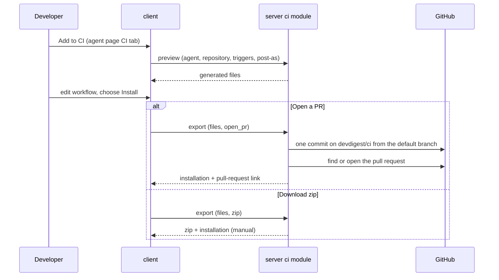
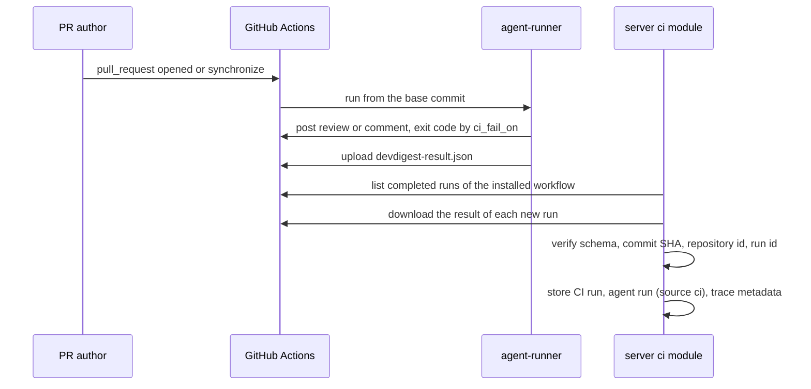

# Spec: Export to CI
Spec ID: SPEC-15
Status: approved
Supersedes: none
Packages: server, client, agent-runner
Sources: user brief (course lab L06 "Hands-On Lab (video 2)", Part 3 "Export to CI", worktree B, translated) · design files in client/docs/design (artboards `export` N12, `ci-runs` N13 and `e-ci` "CI Runs · empty"; the agent page CI tab and Stats run history in screen_agents; the GLOBAL nav section in chrome; CI run sample data in data2) · existing tables and contracts (ci_installations, ci_runs, agent_runs.source, agents.ci_fail_on, AgentManifest, CiExportInput, CiResultArtifact) · the agent-runner package on the training branch `lesson-7-lab/agent-runner` and the example export on `devdigest/ci` · GitHub documentation on workflow-file scopes, fork pull requests, `permissions`, workflow runs, artifacts and action pinning · course lab L06 Part 3 page images (Export Target, agent CI tab, Preview, Configure, Install), compared with the design and the UI on 2026-10-17 · user answers to the discovery questions of 2026-10-17 (every question option 1; proposals P1–P10 accepted) · coordinator review of the draft against the training runner (manifest, artifact, run, index and GitHub calls), 2026-10-17
Amended: 2026-10-17 — AC-32 and AC-33 reworded; AC-122–AC-140, EC-39–EC-41 and NFR-13 added (comparison of the course lab Part 3 page images with the design and the UI, found by the coordinator; fixes M1, M2, M5, M9, M15, M16 chosen by the user)

## Problem and user
A developer tunes a DevDigest review agent on their own machine: its model, system prompt, linked
skills and gate. Only that developer benefits. The agent reviews a pull request only when they import
it and press Run, so the rest of the team cannot rely on it for every pull request. Nothing blocks a
merge when the agent finds a CRITICAL problem. To use the agent in CI today, the developer would have
to rewrite its configuration by hand into a workflow. They would also have to copy a runner into the
repository and get the permissions and secrets right without help. Even then, the results of those
CI reviews would never come back into DevDigest, so nobody can see what the agent did in CI, what it
cost, or which commit it reviewed.

## Goals / Non-goals
**Goals**
- From an agent's page, a four-step wizard (Target → Preview → Configure → Install) opens a pull request on branch `devdigest/ci` in an imported repository, or downloads a zip. Either one holds the agent manifest, its skills, `.devdigest/memory.jsonl`, the bundled runner and `.github/workflows/devdigest-review.yml`.
- After that pull request is merged, every same-repository pull request is reviewed in GitHub Actions with the exported configuration. The result is published as a GitHub review, as a pull-request comment, or only as an exit code.
- With **Fail CI on: Critical**, a CRITICAL finding fails the check. Made required in branch protection, that failed check blocks the merge.
- The generated workflow grants only `contents: read` (plus `pull-requests: write` when it posts), never uses `pull_request_target`, skips fork pull requests, takes the API key only from Actions secrets, and pins every action to a full commit SHA.
- DevDigest pulls each run's `devdigest-result.json` from GitHub. It accepts the result only when its schema, commit SHA, repository id and run id match the GitHub run. It stores the run as an agent run with source `ci`.
- The CI Runs page lists every CI run with repository, pull request, agent, verdict, findings, cost, duration and a link to the GitHub Actions job.
- The agent's CI tab shows its installations, the version each was exported with, the CI run history and the **Fail CI on** setting.

**Non-goals**
- A push endpoint that receives results from CI. A hosted runner cannot reach the local API, and the user chose to pull from GitHub.
- Storing CI findings as finding rows. The user chose counts and metadata only, and the ready runner's result carries no findings. Worktree A's finding attribution is therefore not read.
- CircleCI, Jenkins and Generic CLI targets. They have no generator, and the brief allows a target only when its generator exists.
- Several agents in one repository. The ready runner reads exactly one manifest, and the user chose one agent per repository, replaced after confirmation.
- Exporting the agent's project documents (project context). They are not in the brief, and the runner does not read them.
- A published `devdigest/review-action`. None exists; the workflow runs the runner bundled in the repository.
- Removing an installation from a repository, from the CI tab. It is neither in the design nor in the brief; the user deletes the files with a pull request of their own.
- Approving a pull request from CI. The Actions token cannot approve, so the runner posts COMMENT or REQUEST_CHANGES only.
- Showing CI runs that are still in progress. Only completed runs carry a result.
- The Stats tab and N11 Agent Performance. They come from other lessons and contain no CI behaviour this feature needs.
- Reviewing pull requests from forks. Secrets are unavailable to them and their token is read-only; working around that with `pull_request_target` is forbidden by the brief.
- Any change to the multi-agent run service or the pull-request feed. Worktree A owns them.
- Using the training runner unchanged. agent-runner is copied from the training branch `lesson-7-lab/agent-runner` and then modified, because its manifest and result lack the fields this feature verifies (see "Runner and contract gap").
- A runner that reads `.devdigest/memory.jsonl`. The file is exported because the brief requires it, but nothing in this feature consumes it. This is a known gap: the runner has no memory reader.

## User stories
- US-1: As a developer who tuned an agent, I want to open a pull request that installs the agent in a repository's GitHub Actions, so that the team gets its review on every pull request.
- US-2: As a developer who cannot or will not let DevDigest write to a repository, I want the same files as a zip, so that I can add them myself.
- US-3: As a developer exporting an agent, I want to see and adjust every file before it is written, so that nothing reaches the repository that I did not review.
- US-4: As a repository maintainer reviewing the export pull request, I want the workflow to have minimal permissions, no secrets in files, and no execution of fork code, so that installing it does not open the repository to attack.
- US-5: As a team member opening a pull request, I want the agent's review posted on it by CI, so that I get feedback without anyone running DevDigest.
- US-6: As a maintainer, I want the check to fail when the agent finds a problem at or above a chosen severity, so that a required check can block the merge.
- US-7: As a developer, I want every CI run to appear in DevDigest with its repository, pull request, verdict, findings, cost, duration and job link, so that I can follow what the agent does in CI.
- US-8: As a developer, I want the agent's CI tab to show where it is installed, with which version and with which recent results, so that I know which installations are out of date.
- US-9: As a developer, I want DevDigest to accept only results it can verify against GitHub, so that a forged or mismatched result never enters my statistics.

## Workflow and module interactions

Export (US-1, US-2, US-3):

Review in CI and ingest (US-5, US-6, US-7, US-9):

Contracts that cross a boundary (wire spelling; the manifest and the result are shared by the server and agent-runner, which validate them with the same schema):

- **Agent manifest** (studio writes, runner reads): `name`, `provider`, `model`, `system_prompt`, `skills` (skill slugs), `strategy`, `ci_fail_on`, `manifest_version`, `agent_version`.
- **CI result** (runner writes, server ingests): `findings_count`, `critical`, `warning`, `suggestion`, `verdict`, `cost_usd`, `duration_ms`, `agent`, `manifest_version`, `agent_version`, `runner_version`, `model`, `commit_sha`, `repository_id`, `run_id`, `pr_number`.
- **CI installation** (server → client): `id`, `agent_id`, `repo`, `repository_id`, `target_type`, `method` (`pr` or `manual`), `agent_version`, `runner_version`, `pr_url`, `installed_at`, `outdated`, `last_run_status`, `last_run_at`.
- **CI run** (server → client): `id`, `repo`, `pr_number`, `pr_title`, `pr_id`, `agent_id`, `agent_name`, `source`, `ran_at`, `duration_ms`, `critical`, `warning`, `suggestion`, `verdict`, `cost_usd`, `status` (`succeeded`, `no_findings`, `failed`), `failure_reason`, `job_url`, `commit_sha`, `manifest_version`, `agent_version`, `runner_version`, `model`, `run_id`.

### Runner and contract gap
The "ready" runner on the training branch does not meet the contracts above.
- (a) Its agent manifest has only 7 fields: `name`, `provider`, `model`, `system_prompt`, `skills`, `strategy`, `ci_fail_on`. It has no `manifest_version` or `agent_version`.
- (b) Its result has only `findings_count`, `critical`, `warning`, `suggestion`, `cost_usd`, `duration_ms`, `agent`, `version` (always `'1'`) and `pr_number`. It has no `verdict`, `manifest_version`, `agent_version`, `runner_version`, `model`, `commit_sha`, `repository_id` or `run_id`.

So this feature must change the shared contracts: the server copy first, then `./scripts/shared-contracts.sh sync`. It must also change agent-runner where the result is built and written, and where its inputs are read.

`ci_runs` today has no workspace, commit SHA, GitHub run id or failure reason. It needs a database migration, generated with `pnpm db:generate` and never edited by hand.

`commit_sha` means the pull request's head commit. For the `pull_request` event, the commit Actions checks out by default is a merge commit. The `head_sha` of the GitHub workflow run, which ingest compares against (AC-107), is the pull request's head commit (AC-117, AC-118).

### Ownership, merge order and checks
- Worktree B owns the server `ci` module and its routes, the new `agent-runner` package, the Export Wizard, the agent page CI tab, the CI Runs page and the CI Runs nav entry.
- Worktree B does not change the multi-agent run service or the pull-request feed (NFR-11).
- Worktree A (Multi-Agent Review) merges first. After that merge, the nav section GLOBAL, which both features change, is checked separately (AC-81, AC-82).
- Checks before merge: `pnpm typecheck`, `pnpm lint` and `pnpm test` in server and client; `npm run typecheck` and `npm test` in agent-runner; `./scripts/shared-contracts.sh check`; the L06 evals that apply (OQ-2).

## Acceptance criteria (EARS)

Agent page CI tab and wizard entry
- AC-1 (US-8): The agent page shall show a CI tab after the Evals tab.
- AC-2 (US-1): WHILE an agent has no CI installation, the CI tab shall show the empty state "Not in CI yet" with an "Add to CI" button.
- AC-3 (US-1): WHEN the user clicks "Add to CI", the client shall open the Export Wizard at its first step, with the steps Target, Preview, Configure and Install.
- AC-4 (US-1): IF the agent's provider is not openrouter, THEN the CI tab shall show "Add to CI" disabled with the reason "CI runs support OpenRouter agents only".
- AC-5 (US-1, US-2, US-3): WHEN the user closes the wizard before Install completes, the client shall discard every choice and edit made in it.

Target
- AC-6 (US-1): The Target step shall offer GitHub Actions as the only CI target, preselected.
- AC-7 (US-1): The Target step shall let the user choose the target repository from the workspace's imported repositories.
- AC-8 (US-1): IF the workspace has no imported repository, THEN the Target step shall show "Import a repository first" with Continue disabled.
- AC-9 (US-1): The server shall use the chosen repository's default branch as the base of the export branch.
- AC-10 (US-1): IF the chosen repository has a CI installation of another agent, THEN the wizard shall ask for confirmation, naming that agent, before it continues.
- AC-11 (US-1): WHEN an export completes into a repository that had another agent's installation, the server shall end that installation.
- AC-12 (US-1): WHEN an export completes into a repository that had another agent's installation, the exported files shall contain no manifest of that other agent.

Preview
- AC-13 (US-3): The Preview step shall list the files to create: `.devdigest/agents/<agent-slug>.yaml`, one `.devdigest/skills/<skill-slug>.md` per enabled skill bound to the agent, `.devdigest/memory.jsonl`, the runner files under `.devdigest/runner/`, and `.github/workflows/devdigest-review.yml`.
- AC-14 (US-3): WHEN the user selects a file in the Preview step, the client shall show that file's contents.
- AC-15 (US-3): The Preview step shall show each runner file with its size in place of its contents.
- AC-16 (US-3): The Preview step shall let the user edit the workflow file only, showing every other file read-only.
- AC-17 (US-3): WHEN the user clicks "Reset to generated", the client shall replace the edited workflow with the generated one.
- AC-18 (US-3): IF the edited workflow is not valid YAML, THEN the wizard shall disable Install with the message "The workflow is not valid YAML".

Generated files
- AC-19 (US-1): The manifest shall hold the agent's `name`, `provider`, `model`, `system_prompt`, `strategy`, `ci_fail_on`, its current version as `agent_version`, the manifest schema version as `manifest_version`, and `skills` as the slugs of its enabled bound skills in binding order.
- AC-20 (US-1): IF the generated manifest fails the shared manifest schema, THEN the server shall refuse the preview with the schema's field errors.
- AC-21 (US-1): The server shall derive an agent slug or a skill slug from its name as lowercase ASCII letters, digits and single hyphens, at most 40 characters.
- AC-22 (US-1): IF a name yields an empty slug, THEN the server shall use `agent` for an agent and `skill` for a skill.
- AC-23 (US-1): IF two bound skills yield the same slug, THEN the server shall add the suffix `-2`, `-3`, … to the later ones in binding order.
- AC-24 (US-1): The memory file shall hold one JSON line `{"kind", "content"}` per memory entry scoped to the target repository or to the whole workspace.
- AC-25 (US-1): IF there is no such memory entry, THEN the memory file shall be empty.

Configure
- AC-26 (US-1): The Configure step shall offer the triggers `pull_request:opened`, `pull_request:synchronize` and `pull_request:reopened`, with the first two selected by default.
- AC-27 (US-1): IF no trigger is selected, THEN the Configure step shall disable Continue.
- AC-28 (US-5): The Configure step shall offer "Post results as" with the options "GitHub review" (default), "PR comment" and "None (exit code only)".
- AC-29 (US-3): WHEN the user changes a Configure choice, the client shall regenerate the workflow from the current choices.
- AC-30 (US-3): WHILE the workflow has manual edits, WHEN the user changes a Configure choice, the client shall ask for confirmation that the edits will be lost before it regenerates the workflow.
- AC-31 (US-6): The Configure step shall show the note "To block merges: set Fail CI on (CI tab) so the run exits non-zero, then add a required status check in the repo's GitHub branch protection. No GitHub App needed."
- AC-32 (US-4): WHEN the Configure step opens, the client shall show in the `OPENROUTER_API_KEY` row of the "Secrets expected" panel (AC-122) whether the repository's Actions secrets contain `OPENROUTER_API_KEY`, checked by name only.
- AC-33 (US-4): IF the server cannot read the secret names of the repository, THEN the Configure step shall show the badge "unknown" in the `OPENROUTER_API_KEY` row, in a neutral style distinct from both "set" and "not set". (Amended 2026-10-17: replaces the earlier standalone line "Add OPENROUTER_API_KEY to the repository's Actions secrets before the workflow runs."; the hint of AC-129 is shown in every state.)

Generated workflow
- AC-34 (US-5): The generated workflow shall run on the `pull_request` event with exactly the selected trigger types.
- AC-35 (US-4): The generated workflow shall not contain the `pull_request_target` event.
- AC-36 (US-4): WHERE results are posted as a GitHub review or a PR comment, the generated workflow shall grant exactly `contents: read` and `pull-requests: write`.
- AC-37 (US-4): WHERE results are posted as "None (exit code only)", the generated workflow shall grant exactly `contents: read` and `pull-requests: read` (OQ-4).
- AC-38 (US-4): The generated workflow shall skip the review job for a pull request whose head repository is a fork.
- AC-39 (US-4): The generated workflow shall run the runner, the manifest and the skills as they are in the pull request's base commit.
- AC-40 (US-4): The generated workflow shall reference every action by a full 40-character commit SHA.
- AC-41 (US-4): The generated workflow shall not reference `devdigest/review-action`.
- AC-42 (US-4): The generated workflow shall pass `OPENROUTER_API_KEY` to the review step only from the repository's Actions secrets.
- AC-43 (US-5): The generated workflow shall pass the chosen "Post results as" option to the runner.
- AC-44 (US-7): The generated workflow shall upload `devdigest-result.json` as the artifact `devdigest-result`, including when the review step fails.
- AC-45 (US-5): The generated workflow shall run the runner on Node 22.

Install
- AC-46 (US-1, US-2): The Install step shall offer "Open a PR with these files" (selected by default) and "Download as zip".
- AC-47 (US-1): IF no GitHub token is stored, THEN the Install step shall disable "Open a PR with these files" with the reason "Add a GitHub token in Settings → API Keys".
- AC-48 (US-1): WHILE an install request is in progress, the wizard shall show the Install button disabled with the text "Installing…".
- AC-49 (US-1): WHEN the user installs with "Open a PR with these files", the server shall write all files as one commit on branch `devdigest/ci`, created from the base branch when it does not exist.
- AC-50 (US-4): The server shall not write the exported files to any branch other than `devdigest/ci`.
- AC-51 (US-1): WHEN the export commit is written and no open pull request has head `devdigest/ci`, the server shall open a pull request titled "Add DevDigest CI review" from `devdigest/ci` into the base branch.
- AC-52 (US-1): WHILE an open pull request has head `devdigest/ci`, WHEN the export commit is written, the server shall keep that pull request instead of opening another one.
- AC-53 (US-1): WHEN an install with "Open a PR with these files" succeeds, the wizard shall show a success state with a link to the pull request.
- AC-54 (US-2): WHEN the user installs with "Download as zip", the client shall download `devdigest-ci.zip` holding every file of the Preview step at its path.
- AC-55 (US-1, US-2): WHEN an install succeeds, the server shall record an installation with the agent, the repository and its GitHub id, the target GitHub Actions, the method (`pr` or `manual`), the agent version, the runner version and the time.
- AC-56 (US-4): IF any file to install contains a secret-shaped value, THEN the server shall refuse the install with a message naming that file.
- AC-57 (US-1): IF GitHub refuses to write the workflow file because the token lacks the workflow permission, THEN the wizard shall show "The GitHub token needs the workflow scope (classic token) or Workflows: write (fine-grained token)".
- AC-58 (US-1): IF the install fails for any other reason, THEN the wizard shall stay on the Install step with the mapped error message and Install enabled.
- AC-59 (US-1): IF an install fails, THEN the server shall record no installation.

Runner in CI
- AC-60 (US-5): WHEN the workflow runs for a same-repository pull request, the runner shall review the pull request's diff with the manifest's model, system prompt, skills and strategy.
- AC-61 (US-5): The runner shall leave files under `.devdigest/` and `.github/workflows/` out of the reviewed diff.
- AC-62 (US-1): IF the manifest fails the shared manifest schema, THEN the runner shall exit non-zero without posting.
- AC-63 (US-6): WHERE results are posted as a GitHub review, the runner shall post the review with the event REQUEST_CHANGES when a finding is at or above the `ci_fail_on` severity.
- AC-64 (US-5): WHERE results are posted as a GitHub review, the runner shall post the review with the event COMMENT when no finding is at or above the `ci_fail_on` severity.
- AC-65 (US-5): WHERE results are posted as a PR comment, the runner shall post one pull-request comment with the review.
- AC-66 (US-5): WHERE results are posted as "None (exit code only)", the runner shall post nothing to the pull request.
- AC-67 (US-6): WHEN a completed review has a finding at or above the `ci_fail_on` severity, the runner shall exit with code 1.
- AC-68 (US-6): WHEN a completed review has no finding at or above the `ci_fail_on` severity, the runner shall exit with code 0.
- AC-69 (US-6): WHERE `ci_fail_on` is `never`, the runner shall exit with code 0 for every completed review.
- AC-70 (US-5): IF the review cannot complete, THEN the runner shall exit with code 1 without posting.
- AC-71 (US-7, US-9): WHEN a review completes, the runner shall write `devdigest-result.json` with every field of the CI result contract.
- AC-72 (US-4): The runner shall not write a secret, the pull-request title, the pull-request body, the diff or any finding text into `devdigest-result.json`.

Fail CI on and installations on the CI tab
- AC-73 (US-6): The CI tab shall show the control "Fail CI on" with the options Critical, Warning + and Never, with the agent's stored value selected.
- AC-74 (US-6): WHILE the agent's stored `ci_fail_on` is `any`, the "Fail CI on" control shall show a fourth option "Any", selected.
- AC-75 (US-6): WHEN the user picks a "Fail CI on" option, the client shall save it as the agent's `ci_fail_on`.
- AC-76 (US-8): WHILE an agent has installations, the CI tab shall show one row per installation with repository, target, method, exported agent version, last run status and last run time.
- AC-77 (US-8): WHILE an installation has no ingested run, the CI tab shall show "Waiting for first run" in its row, with a link to its pull request when it has one.
- AC-78 (US-8): WHILE the manifest generated now differs from an installation's exported manifest, the CI tab shall show "Outdated" in that installation's row.
- AC-79 (US-8): WHEN the user clicks "Update CI config" on an installation, the client shall open the Export Wizard with that installation's repository and last Configure choices preselected.
- AC-80 (US-8): The CI tab shall show the agent's 20 newest CI runs with a link "All CI runs" to the CI Runs page filtered by the agent.

Navigation
- AC-81 (US-7): The navigation shall show "CI Runs" in the GLOBAL section, linking to `/ci-runs`.
- AC-82 (US-7): WHERE the GLOBAL section also holds "Multi-Agent Review", the navigation shall list "CI Runs" after it.

CI Runs page
- AC-83 (US-7): The CI Runs page shall list stored CI runs newest first, 50 per page, with a "Load more" control while more remain.
- AC-84 (US-7): The CI Runs page shall show in each row the timestamp, repository, pull request number and title, agent, source, duration, findings per severity, verdict, cost, status, a "Job" link and a "Trace" link.
- AC-85 (US-7): IF a CI run has no cost or no duration, THEN the CI Runs page shall show `—` in that cell.
- AC-86 (US-7): IF a CI run has no findings, THEN the CI Runs page shall show `—` in its findings cell.
- AC-87 (US-7): The server shall set a CI run's status to Succeeded for a verified result with at least one finding, to No findings for a verified result with none, and to Failed otherwise.
- AC-88 (US-7): WHEN the user clicks "Job", the client shall open the run's GitHub Actions page in a new tab.
- AC-89 (US-7): WHEN the user clicks "Trace", the client shall show the run's manifest version, agent version, runner version, model, commit SHA, repository and GitHub run id.
- AC-90 (US-7): WHILE a CI run's pull request is imported into DevDigest, the CI Runs page shall link its pull-request cell to the DevDigest pull-request page.
- AC-91 (US-7): IF a CI run's pull request is not imported into DevDigest, THEN the CI Runs page shall link its pull-request cell to the pull request on GitHub.
- AC-92 (US-7): IF a CI run's agent no longer exists, THEN the CI Runs page shall show the agent name from the stored result in its agent cell.
- AC-93 (US-7): IF a CI run is Failed, THEN the CI Runs page shall show its failure reason on hover and on keyboard focus of its status badge.
- AC-94 (US-7): The CI Runs page shall offer the filters period (Last 7 days by default, Last 30 days, All time), agent, repository and status.
- AC-95 (US-7): IF no CI run matches the filters, THEN the CI Runs page shall show "No runs match these filters".
- AC-96 (US-7): WHILE no CI run is stored in the workspace, the CI Runs page shall show the empty state "No CI runs yet" with the button "Set up CI for an agent", linking to the Agents page.
- AC-97 (US-7): WHILE the CI run list loads, the CI Runs page shall show a loading state.
- AC-98 (US-7): IF the CI run list fails to load, THEN the CI Runs page shall show an error with a Retry button.

Refresh and ingest
- AC-99 (US-7): WHILE the CI Runs page or an agent's CI tab is open, the client shall request a refresh every 60 s.
- AC-100 (US-7): WHEN the user clicks Refresh, the server shall ingest the new runs of every installation in the workspace.
- AC-101 (US-7): WHEN an automatic refresh arrives within 30 s of the last ingest of an installation, the server shall skip that installation.
- AC-102 (US-7, US-9): WHEN the server ingests an installation, the server shall read only completed runs of the installed workflow file in the installation's repository that started after the installation time.
- AC-103 (US-7): WHEN a completed run has a result that passes every check, the server shall store a CI run with the result's values.
- AC-104 (US-7): WHEN a completed run has a result that passes every check, the server shall store an agent run with source `ci` and the result's model, cost, duration and findings count.
- AC-105 (US-7): WHEN a completed run has a result that passes every check, the server shall store the run's trace metadata: manifest version, agent version, runner version, model and commit SHA.
- AC-106 (US-9): IF a result fails the shared result schema, THEN the server shall store the run as Failed with the reason `invalid_result`.
- AC-107 (US-9): IF a result's `commit_sha` differs from the GitHub run's head commit, THEN the server shall store the run as Failed with the reason `commit_mismatch`.
- AC-108 (US-9): IF a result's `repository_id` differs from the installation's repository id, THEN the server shall store the run as Failed with the reason `repository_mismatch`.
- AC-109 (US-9): IF a result's `run_id` differs from the GitHub run it was downloaded from, THEN the server shall store the run as Failed with the reason `run_mismatch`.
- AC-110 (US-9): IF a result is larger than 256 KB, THEN the server shall store the run as Failed with the reason `result_too_large`.
- AC-111 (US-9): IF a result contains a secret-shaped value, THEN the server shall store the run as Failed with the reason `secret_in_result`.
- AC-112 (US-7): IF a completed run has no result artifact, THEN the server shall store the run as Failed with the reason `no_result`.
- AC-113 (US-7): IF a run's result artifact has expired, THEN the server shall store the run as Failed with the reason `result_expired`.
- AC-114 (US-9): IF a result is rejected, THEN the server shall store no agent run for it.
- AC-115 (US-7): The server shall store at most one CI run per GitHub run id.
- AC-116 (US-7): IF GitHub fails during a refresh, THEN the CI Runs page shall keep the stored runs with the notice "Could not refresh from GitHub — showing stored runs".

Added after review against the training runner
- AC-117 (US-9): The generated workflow shall pass the pull request's head commit SHA (`github.event.pull_request.head.sha`) to the runner.
- AC-118 (US-9): The runner shall write the head commit SHA passed by the workflow as `commit_sha` in `devdigest-result.json`.
- AC-119 (US-5): The generated workflow shall skip the review job when the pull request's base commit has no runner files under `.devdigest/runner/`.
- AC-120 (US-7): The server shall store no CI run for a workflow run whose review job was skipped.
- AC-121 (US-7): WHERE an installation's method is `pr`, the server shall record as its installation time the moment it opened or updated the export pull request.

Added after comparison with the course lab page images (amendment of 2026-10-17)
- AC-122 (US-4): The Configure step shall show a panel titled "Secrets expected" between the Trigger chips and "Post results as".
- AC-123 (US-4): The "Secrets expected" panel shall show exactly two rows, `OPENROUTER_API_KEY` first and `GITHUB_TOKEN` second.
- AC-124 (US-4): The `OPENROUTER_API_KEY` row shall show the description "Your OpenRouter key".
- AC-125 (US-4): WHILE the repository's Actions secrets list `OPENROUTER_API_KEY`, the `OPENROUTER_API_KEY` row shall show the badge "set".
- AC-126 (US-4): IF the repository's Actions secrets do not list `OPENROUTER_API_KEY`, THEN the `OPENROUTER_API_KEY` row shall show the badge "not set".
- AC-127 (US-4): The `GITHUB_TOKEN` row shall show the description "Auto-provided by Actions".
- AC-128 (US-4): The `GITHUB_TOKEN` row shall show the badge "ready".
- AC-129 (US-4): The Configure step shall show under the "Secrets expected" panel the hint "Add these to your repo's Actions secrets before the workflow runs."
- AC-130 (US-4): The "Secrets expected" panel shall show secret names, descriptions and status badges only, never a secret value.
- AC-131 (US-1): The Configure step shall show the triggers of AC-26 as chips in one row that wraps onto the next line when it does not fit.
- AC-132 (US-1): WHILE a trigger is selected, the Configure step shall show a check mark in that trigger's chip.
- AC-133 (US-1): WHEN the user activates a trigger chip, the client shall toggle that trigger between selected and not selected.
- AC-134 (US-1, US-2): The Install step shall show, centered under the two install options, the line "Need help? See the GitHub Action setup docs →", with "GitHub Action setup docs →" as a link.
- AC-135 (US-1, US-2): WHEN the user clicks the "GitHub Action setup docs" link, the client shall open `https://docs.github.com/en/actions` in a new tab.
- AC-136 (US-4): The "GitHub Action setup docs" link shall carry `rel="noopener noreferrer"`, so the opened page gets no access to the DevDigest window and no referrer.
- AC-137 (US-1): WHILE an agent has at least one installation, the CI tab shall show a full-width button "Add repository" with a dashed border under the last installation row.
- AC-138 (US-1): WHEN the user clicks "Add repository", the client shall open the Export Wizard at its first step with no repository preselected and the default Configure choices, the same as "Add to CI" (AC-3).
- AC-139 (US-6): WHILE an agent has at least one installation, the CI tab shall show the "Fail CI on" control below the "CI deployment" heading row and above the first installation row.
- AC-140 (US-1): The generated workflow shall have the top-level `name` "DevDigest Review".

## Edge cases
- EC-1: an agent is exported to a repository that already runs another agent → the user confirms, that installation ends and its manifest leaves the branch (AC-10)
- EC-2: the other agent's manifest would remain in the exported files → it is left out, so the runner finds exactly one manifest (AC-12)
- EC-3: `devdigest/ci` already has an open pull request from an earlier export → the new commit goes onto it and no second pull request opens (AC-52)
- EC-4: `devdigest/ci` exists but its pull request was merged or closed → a new pull request opens (AC-51)
- EC-5: the GitHub token lacks the `workflow` scope → the wizard names the missing permission (AC-57)
- EC-6: the base branch was deleted, or GitHub is down during install → the error is shown, the user can retry, and nothing is recorded (AC-58)
- EC-7: no GitHub token is stored → "Open a PR" is disabled; the zip still works (AC-47)
- EC-8: a pull request comes from a fork → the job is skipped and no run is listed (AC-38)
- EC-9: a pull request edits `.devdigest/runner/` to read the API key → CI runs the base commit's runner, not the edited one (AC-39)
- EC-10: the runner fails (missing key, model error) → no result is uploaded, and the run is listed as Failed with `no_result` (AC-112)
- EC-11: a result names another commit → it is rejected as `commit_mismatch` and no agent run is stored (AC-107)
- EC-12: a result from another repository is uploaded → it is rejected as `repository_mismatch` (AC-108)
- EC-13: a result is copied from another run → it is rejected as `run_mismatch` (AC-109)
- EC-14: Refresh is clicked twice, or two tabs refresh at once → each GitHub run is stored once (AC-115)
- EC-15: a result is downloaded after GitHub's retention period → the run is Failed with `result_expired` (AC-113)
- EC-16: the pull request reviewed in CI was never imported into DevDigest → the row links to the pull request on GitHub (AC-91)
- EC-17: the agent is deleted after export → its CI runs stay listed under the agent name from the result (AC-92)
- EC-18: Fail CI on, the prompt, the model or a skill changes after export → the installation shows Outdated until "Update CI config" (AC-78)
- EC-19: the agent's provider is openai or anthropic → "Add to CI" is disabled with a reason (AC-4)
- EC-20: a skill binding is disabled → that skill is not exported (AC-19)
- EC-21: two bound skills have names that give the same slug → the later one gets `-2` (AC-23)
- EC-22: an agent name has no ASCII letters or digits → the slug is `agent` (AC-22)
- EC-23: the repository's default branch is not `main` → the export branch starts from the actual default branch (AC-9)
- EC-24: the user edits the workflow so that it no longer uploads the result → its runs are listed as Failed with `no_result` (AC-112)
- EC-25: the system prompt or a skill holds a string shaped like a key → the install is refused, naming the file (AC-56)
- EC-26: the workspace has no memory entries → `.devdigest/memory.jsonl` is an empty file (AC-25)
- EC-27: the user unticks every trigger → Continue is disabled (AC-27)
- EC-28: an agent was stored with `ci_fail_on: any` through the API → the control shows "Any" selected (AC-74)
- EC-29: the edited workflow has a YAML syntax error → Install is disabled (AC-18)
- EC-30: the user edits the workflow, then changes "Post results as" → a confirmation warns that the edits will be lost (AC-30)
- EC-31: the user closes the wizard on the Configure step → nothing is written and nothing is recorded (AC-5)
- EC-32: the files were installed from the zip → runs are ingested as soon as the user commits the workflow (AC-102)
- EC-33: the repository had workflow runs before the installation, or runs of another workflow file → they are not ingested (AC-102)
- EC-34: GitHub is down during a refresh → stored runs stay visible with a notice (AC-116)
- EC-35: Actions checks out the merge commit of a `pull_request` run → the result still carries the PR head commit, so `commit_sha` matches the run's `head_sha` (AC-118)
- EC-36: the export pull request triggers the workflow before it is merged, and its base has no runner yet → the review job is skipped (AC-119)
- EC-37: runs that happen after the installation time but before the export pull request is merged → a run whose review job was skipped is not listed; a run whose review job ran is ingested by the normal rules (AC-120)
- EC-38: a private repository with results posted as "None" → the workflow still grants read access to pull requests, so the runner can fetch the diff (AC-37)
- EC-39: the server cannot read the repository's secret names (the token lacks the permission, or GitHub fails) → the `OPENROUTER_API_KEY` row shows the neutral badge "unknown" and the hint stays shown (AC-33)
- EC-40: the agent already has installations and the user clicks "Add repository" → the wizard opens fresh, with none of an installation's choices preselected (AC-138)
- EC-41: the agent has no installation → the "Fail CI on" control is still shown, together with the empty state "Not in CI yet" (AC-73)

## Non-functional requirements
- NFR-1: Cost — preview, export, refresh and ingest make 0 model calls in DevDigest. In CI, each pull-request event that matches a trigger makes one review with the agent's configuration, billed to the repository's `OPENROUTER_API_KEY`.
- NFR-2: Security — no secret value appears in any exported file, `devdigest-result.json`, a stored CI run, a trace, an API response or a log line. The wizard reads secret names only, never values.
- NFR-3: Security — no route of the API accepts a CI result from a caller. Results enter DevDigest only by the server downloading them from GitHub with the stored GitHub token.
- NFR-4: Security — every CI route resolves the caller's workspace, and returns only installations and runs of that workspace.
- NFR-5: Security — the install route is limited to 10 requests per minute and the refresh route to 30 requests per minute per client (OQ-1).
- NFR-6: Security — a downloaded result archive is read only for the expected file name, with no entry over 256 KB and no path outside the archive.
- NFR-7: Accessibility — the wizard traps focus while open, closes on Esc, and names its current step for screen readers. "Fail CI on" is a radio group that the keyboard can operate. Every "Job" and "Trace" link has an accessible name that includes the run's pull-request number.
- NFR-8: i18n — every new UI string is in the `ci` messages namespace. The strings that contradict the design ("Requires a GitHub App") are replaced by the design's text.
- NFR-9: Observability — each rejected result is logged with its reason, installation id and GitHub run id, and without the result's contents.
- NFR-10: Reliability — a refresh reads at most the 20 newest completed runs per installation (OQ-3).
- NFR-11: Scope — the change set of this feature leaves the multi-agent run service and the pull-request feed unchanged.
- NFR-12: Contract parity — the server and agent-runner validate the manifest and the result with one shared schema. The shared-contracts check passes.
- NFR-13: Accessibility — each trigger chip of the Configure step is reachable with Tab, toggles with Space and with Enter, and exposes its selected state to assistive technology as checked or not checked. Each badge of the "Secrets expected" panel states its status in text, not by colour alone.

## Inputs and provenance
| Input | Provenance | Notes |
|---|---|---|
| Agent name, provider, model, system prompt, strategy, `ci_fail_on`, version | [reused: agents] | Stored agent configuration |
| Enabled bound skills (name, body, order) | [reused: skills] | Bindings with `enabled` off are left out |
| Memory entries of the repository and the workspace | [reused: memory] | Likely empty today; no feature writes them yet. Exported as the brief requires; the runner does not read the file in this feature |
| Imported repositories, default branch, GitHub repository id | [reused: repos] | Target list and export base |
| Manifest, workflow, file list, slugs | [deterministic: ci] | Generated by code from the inputs above and the Configure choices |
| Runner bundle | [reused: agent-runner] | Built from the agent-runner package |
| Secret names of the repository | [deterministic: GitHub API] | Names only; never values |
| Review in CI: findings, verdict, cost | [new: 1 LLM call] | One review per triggering pull-request event, run inside GitHub Actions on the repository's key. Running the agent where the pull request lives is the point of the feature; nothing in DevDigest can produce it |
| CI result: counts, verdict, cost, duration, versions, commit SHA, repository id, run id | [reused: CI result artifact] | Written by the runner, verified on ingest |
| Workflow run metadata: run id, head commit, repository id, conclusion, job link, times | [deterministic: GitHub API] | The reference every result is checked against |
| Pull-request title of a CI run | [deterministic: GitHub API] | Shown in CI Runs |
| Gate outcome and review event | [deterministic: reviewer-core gate] | From `ci_fail_on` and finding severities, no model |

## Untrusted inputs
| Input | Who controls it | Where it goes | Required handling |
|---|---|---|---|
| Pull-request diff, title, body | Pull-request author | The runner's prompt in CI | Fenced as untrusted data with the injection guard. Never turned into a shell command, a path or a permission |
| Pull-request branch and changed files, including `.devdigest/**` and workflow edits | Pull-request author | The CI checkout | Runner, manifest and skills are taken from the base commit (AC-39); fork pull requests do not run (AC-38); no `pull_request_target` (AC-35) |
| Model output in CI (findings, review body) | Steerable through the pull-request text | GitHub review or comment | Posted as text by the runner; never stored by DevDigest (counts only) |
| `devdigest-result.json` and its archive | Whoever can change the workflow or the runner in the repository | Server ingest, stored CI runs, CI Runs page | Schema, commit SHA, repository id, run id, size and secret checks before storing (AC-106–AC-113); its strings are rendered as text, never as HTML |
| Pull-request title from GitHub | Pull-request author | CI Runs page | Rendered as text, truncated with an ellipsis |
| Agent system prompt and skill bodies (skills may be URL-imported) | Workspace user; the author of an imported skill | Files committed to the target repository | Secret-shaped values refused before install (AC-56); written as YAML values by the generator, never interpolated into a workflow command |
| Edited workflow text | Workspace user | Committed to the target repository | Must parse as YAML (AC-18). The user owns its content; it is committed as edited |
| Error messages from GitHub during install or refresh | GitHub | Wizard and CI Runs notices | Mapped to fixed messages; no token or raw response body is shown |

## Open questions
- OQ-1: Are 10 per minute (install) and 30 per minute (refresh) the right rate limits? — default if unanswered: those values, in line with the existing 10 per minute on review routes.
- OQ-2: Which L06 evals must pass before merge? — default if unanswered: the per-package checks listed under "Ownership, merge order and checks", plus `pnpm eval:static` when a harness file changes.
- OQ-3: Is reading the 20 newest completed runs per installation per refresh enough? — default if unanswered: 20, which covers more than 20 pull-request events between two refreshes 60 s apart.
- OQ-4: The runner fetches the diff through the pull-request endpoint with the diff media type. Does that call need `pull-requests: read` on a private repository when results are posted as "None"? — default if unanswered: `pull-requests: read` for "None" and `pull-requests: write` otherwise (AC-36, AC-37), to be verified on the demo fork.
- OQ-5: How does the server get the built runner bundle it exports? — default if unanswered: none; the brainstorm decides it, and the spec does not.
