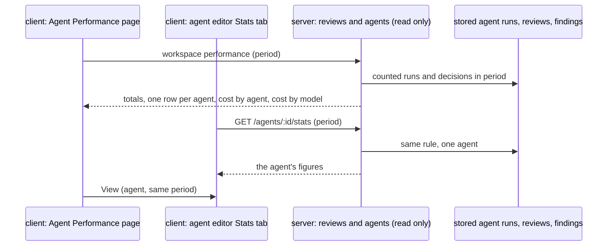

# Spec: Agent Performance
Spec ID: SPEC-16
Status: implemented
Supersedes: none
Amended: 2026-10-21 — AC-54 reworded: one "DevDigest estimate" label per group of cost figures (tile, column, section) instead of one per figure (verifier finding, decided by the user)
Packages: server, client
Sources: user brief (GoIT L08 optional homework "Agent Performance Dashboard у DevDigest", relayed 2026-10-21) · user answers to the discovery questions (2026-10-21) · client/docs/design/artboards.md (`agent-perf` N11, `agent-stats`) · client/docs/design/src/screen_agentperf.jsx · client/docs/design/src/screen_agents.jsx (Stats tab) · current code of the reviews, agents, ci and eval modules, the app shell and the CI Runs page · specs/13-eval-pipeline.md · specs/14-multi-agent-review.md · specs/15-export-to-ci.md

## Problem and user
A developer or team lead who runs several review agents cannot tell which agents earn their
keep. The numbers exist: every stored agent run has its duration, cost and model, and every
finding the developer accepted or dismissed is stored. But the product shows them only one run or
one pull request at a time. To learn how often an agent is right, what it costs, or which model
eats the budget, the developer opens runs one by one and adds them up by hand. The agent editor
has no Stats tab, so even a single agent's figures for a period are not visible. Cost figures
look exact, although DevDigest computes them itself and never checks them against the provider's
bill.

## Goals / Non-goals
**Goals**
- One global page shows, for a chosen period (1 day, 30 days or a custom range), total runs, total
  cost, the pooled accept rate and the most-active agent of the workspace.
- One table compares every agent on runs, average cost, average duration, accept rate (with its
  denominator) and last run. It sorts by accept rate without ranking a small sample above a real
  one.
- The cost breakdown by agent and by model adds up exactly to the total cost.
- The agent editor's Stats tab shows the same figures for one agent and the same period, and the
  dashboard row of that agent matches it.
- Every cost is marked as a DevDigest estimate, not reconciled billing.
- Loading, error, an empty workspace, an empty period and an agent without runs each have their
  own state; no state shows a made-up zero.
- The feature adds no model call: it reads only stored runs and finding decisions.

**Non-goals**
- Reconciling cost with provider billing, or storing whether a run's cost came from the provider
  or from the price table — the user chose to label every cost a DevDigest estimate and to store
  no new data.
- Period-over-period deltas (the design's accept-rate arrows and "-$1.20") and the summary
  sparkline — they need a comparison period nobody asked for (proposal P6, accepted).
- The design's other Stats-tab panels (most-used skills, most-pulled memory, findings by severity
  or category, run history) — not in the brief; this spec builds only the figures the dashboard
  must match.
- Counting eval runs — SPEC-13 keeps production statistics free of eval runs.
- A repository or source filter on the page — not in the brief.
- A cap on the length of a custom range — the user chose no cap.

## User stories
- US-1: As a team lead running several review agents, I want every agent's runs, cost, duration and accept rate for one period on one page, so that I can see which agents are worth keeping.
- US-2: As a team lead, I want the period's total cost split by agent and by model, so that I know where the money goes.
- US-3: As a team lead, I want each accept rate shown with the number of decisions behind it, so that I do not trust a rate built on a handful of findings.
- US-4: As a developer tuning one agent, I want a Stats tab in the agent editor with that agent's figures for a period, so that I can check one agent without the whole dashboard.
- US-5: As a developer, I want the page to say clearly when it is loading, failed or has no data, so that I never read a placeholder as a real number.
- US-6: As a developer, I want to open, reload, sort and expand the dashboard without starting a review, so that looking at statistics costs nothing.
- US-7: As a team lead, I want every cost marked as a DevDigest estimate, so that I do not mistake it for my provider's bill.

## Workflow and module interactions

Terms used below:
- **Period.** "1 day" is the 24 hours that end when the figures are read; "30 days" is the 30 × 24
  hours that end then. A custom range runs from the start of its start date to the end of its end
  date, both included, in the browser's timezone.
- **Counted run.** A stored agent run of the caller's workspace that started inside the period and
  ended as done, failed or cancelled. Local and CI runs both count. A run still running is not
  counted until it ends. Eval runs are never agent runs and never count.
- **Decision.** A finding of a counted run that the user accepted or dismissed. A finding with
  neither is pending. A decision belongs to the period of its run's start time, whenever it was
  made. CI runs have no findings in the studio, so they add runs but no decisions.
- **Accept rate.** Accepted decisions ÷ all decisions (accepted + dismissed), as a percentage.
  The page-wide "Avg accept rate" pools every decision of the period (Σ accepted ÷ Σ decisions).
- **Priced run.** A counted run with a stored cost.
- **Small sample.** Fewer than 10 decisions in the period.
- **Deleted agent.** Counted runs whose agent was deleted after the run are grouped as one
  "Deleted agent".

The same server rule computes the per-agent Stats read and the dashboard read. How the two reads
share it is a brainstorm choice; this spec states the observable equality (AC-83 to AC-87).

Contract fields that cross the server → client boundary (wire spelling):
- per-agent stats (`GET /agents/:id/stats`, extending the existing `AgentStats` contract) with the
  period as query parameters (`period` = `1d` | `30d` | `custom`, and `from` and `to` dates for
  `custom`): `agent_id`, `agent_name`, `runs`, `runs_done`, `runs_failed`, `runs_cancelled`,
  `accepted`, `dismissed`, `pending`, `accept_rate`, `total_cost_usd`, `avg_cost_usd`,
  `cost_partial`, `avg_duration_ms`, `last_run_at`, cost per model (`model`, `cost_usd`).
- workspace performance for the same period: the totals (`runs`, `total_cost_usd`, `cost_partial`,
  `accepted`, `dismissed`, `accept_rate`, the most-active agent), one per-agent entry with the
  per-agent stats fields (the deleted-agent entry has a null `agent_id`), cost by agent and cost
  by model, and whether the workspace has any counted run outside the period.
- A null `accept_rate`, `avg_cost_usd` or `avg_duration_ms` means "no data", never 0.

## Acceptance criteria (EARS)
**Navigation**
- AC-1 (US-1): The sidebar shall show an "Agent Performance" item in its GLOBAL section.
- AC-2 (US-1): WHEN the user activates the "Agent Performance" sidebar item, the client shall open the Agent Performance page.
- AC-3 (US-1): WHILE the Agent Performance page is open, the sidebar shall mark the "Agent Performance" item as active.

**Period**
- AC-4 (US-1): The Agent Performance page shall offer the periods "1 day", "30 days" and "Custom range".
- AC-5 (US-1): WHEN the user opens the Agent Performance page with no period in its URL, the page shall show the period "30 days".
- AC-6 (US-1): WHEN the user selects a period, the page shall show every figure computed over the counted runs of that period.
- AC-7 (US-1): WHEN the user selects "Custom range", the page shall ask for a start date and an end date.
- AC-8 (US-1): IF the custom range's start date is after its end date or its end date is after today, THEN the page shall show a validation message next to the date fields.
- AC-9 (US-1): IF the custom range's start date is after its end date or its end date is after today, THEN the page shall keep showing the figures of the previously selected period.
- AC-10 (US-1): WHEN the user reloads the Agent Performance page, the page shall show the period that was selected before the reload.
- AC-11 (US-1): IF the page's URL names an unknown period or an invalid custom range, THEN the page shall show the period "30 days".
- AC-12 (US-1): The summary tiles shall name the selected period in their labels.

**Summary tiles**
- AC-13 (US-1): The Total runs tile shall show the number of counted runs in the period.
- AC-14 (US-2): The Total cost tile shall show the sum of the stored costs of the period's priced runs.
- AC-15 (US-2, US-7): IF a counted run in the period has no stored cost, THEN the Total cost tile shall mark the total as partial.
- AC-16 (US-3): The Avg accept rate tile shall show the period's accepted decisions divided by all its decisions, as a percentage.
- AC-17 (US-3): The Avg accept rate tile shall show the number of decisions its rate is computed from.
- AC-18 (US-3): The Avg accept rate tile shall show the number of counted runs in the period.
- AC-19 (US-3, US-5): IF the period has no decision, THEN the Avg accept rate tile shall show "—" as the rate.
- AC-20 (US-1): The Most-active agent tile shall show the name of the agent with the most counted runs in the period.
- AC-21 (US-1): The Most-active agent tile shall show that agent's number of counted runs in the period.
- AC-22 (US-1): IF two or more agents share the highest number of counted runs, THEN the Most-active agent tile shall show the one whose newest counted run started last.

**Agents table**
- AC-23 (US-1): The agents table shall show one row for every agent of the workspace, enabled or disabled.
- AC-24 (US-1): The agents table shall show the columns Agent, Runs, Avg cost, Avg duration, Accept rate, Last run and View.
- AC-25 (US-1): The agents table shall show in the Runs column the agent's number of counted runs in the period.
- AC-26 (US-1, US-2): The agents table shall show in the Avg cost column the sum of the agent's stored costs divided by its number of priced runs in the period.
- AC-27 (US-1, US-7): IF one of the agent's counted runs has no stored cost, THEN the agents table shall mark that agent's Avg cost as partial.
- AC-28 (US-1): The agents table shall show in the Avg duration column the mean stored duration of the agent's done runs in the period.
- AC-29 (US-3): The agents table shall show in the Accept rate column the agent's accepted decisions divided by its decisions in the period, as a percentage.
- AC-30 (US-3): The agents table shall show the agent's number of decisions in the period next to its accept rate.
- AC-31 (US-1): The agents table shall show in the Last run column the start time of the agent's newest counted run in the period.
- AC-32 (US-3, US-5): IF an agent has no decision in the period, THEN the agents table shall show "—" as that agent's accept rate.
- AC-33 (US-5): IF an agent has no priced run in the period, THEN the agents table shall show "—" as that agent's Avg cost.
- AC-34 (US-5): IF an agent has no done run with a stored duration in the period, THEN the agents table shall show "—" as that agent's Avg duration.
- AC-35 (US-1, US-5): IF an agent has no counted run in the period, THEN the agents table shall show "No runs in this period" in that agent's row in place of its figures.
- AC-36 (US-1, US-2): WHILE the period has counted runs whose agent was deleted, the agents table shall show those runs as one row named "Deleted agent".
- AC-37 (US-1): The agents table shall show no View link in the "Deleted agent" row.

**Small sample and sorting**
- AC-38 (US-3): WHILE an agent has fewer than 10 decisions in the period, the agents table shall show a "small sample" mark next to that agent's accept rate.
- AC-39 (US-3): WHEN the user activates the Accept rate column header, the agents table shall order its rows by accept rate, highest first.
- AC-40 (US-3): WHEN the user activates the Accept rate column header while the rows are ordered highest first, the agents table shall order its rows by accept rate, lowest first.
- AC-41 (US-3): WHILE the agents table is ordered by accept rate, the agents table shall place every agent with fewer than 10 decisions after every agent with 10 or more decisions.

**Expanded row**
- AC-42 (US-1): WHEN the user activates a row's expand control, the agents table shall show that agent's details under the row.
- AC-43 (US-1): WHEN the user activates the expand control of an expanded row, the agents table shall hide that agent's details.
- AC-44 (US-1): The expanded details shall show the agent's number of counted runs per state done, failed and cancelled.
- AC-45 (US-3): The expanded details shall show the agent's number of accepted, dismissed and pending findings of its counted runs.
- AC-46 (US-2): The expanded details shall show the agent's cost per model over its priced runs in the period.

**View**
- AC-47 (US-1, US-4): WHEN the user activates an agent's View link, the client shall open that agent's Stats tab with the period selected on the Agent Performance page.

**Cost breakdown**
- AC-48 (US-2): The cost breakdown shall show the period's cost by agent, one slice per agent with a priced run in the period.
- AC-49 (US-2): The cost breakdown shall show the period's cost by model, one slice per model stored on a priced run of the period.
- AC-50 (US-2): The cost-by-agent slices shall add up to the Total cost tile's amount.
- AC-51 (US-2): The cost-by-model slices shall add up to the Total cost tile's amount.
- AC-52 (US-2, US-7): IF a counted run in the period has no stored cost, THEN the cost breakdown shall mark itself as partial.
- AC-53 (US-2, US-5): IF the period has no priced run, THEN the cost breakdown shall show "No cost recorded yet." in place of the slices.

**Cost provenance**
- AC-54 (US-7): The Agent Performance page shall label each group of cost figures (a summary tile, a table column, a breakdown section) "DevDigest estimate".
- AC-55 (US-7): The Agent Performance page shall show a note that its costs are not reconciled with provider billing.

**Page states**
- AC-56 (US-5): WHILE the Agent Performance page loads its figures, the page shall show loading placeholders in place of the tiles, the agents table and the cost breakdown.
- AC-57 (US-5): WHILE the Agent Performance page loads its figures, the page shall show no run count, cost, duration or rate.
- AC-58 (US-5): IF loading the figures fails, THEN the Agent Performance page shall show the app's error state with a retry action.
- AC-59 (US-5): IF loading the figures fails, THEN the Agent Performance page shall show no run count, cost, duration or rate.
- AC-60 (US-5): IF the workspace has no counted run in any period, THEN the Agent Performance page shall show the empty state "No agent runs yet".
- AC-61 (US-5): IF the selected period has no counted run while the workspace has counted runs outside it, THEN the Agent Performance page shall show "No runs in this period".
- AC-62 (US-5): WHILE the selected period has no counted run, the Agent Performance page shall keep its period control available.

**No model calls**
- AC-63 (US-6): WHEN the user opens or reloads the Agent Performance page, the system shall start no review run.
- AC-64 (US-6): WHEN the user sorts the agents table, the system shall start no review run.
- AC-65 (US-6): WHEN the user expands or collapses a row, the system shall start no review run.
- AC-66 (US-6): WHEN the user opens an agent's Stats tab, the system shall start no review run.

**Stats tab (agent editor)**
- AC-67 (US-4): The agent editor shall offer a Stats tab.
- AC-68 (US-4): The Stats tab shall offer the periods "1 day", "30 days" and "Custom range" under the same rules as the Agent Performance page.
- AC-69 (US-4): WHEN the user opens the Stats tab with no period in its URL, the Stats tab shall show the period "30 days".
- AC-70 (US-4): WHEN the user reloads the agent editor on the Stats tab, the Stats tab shall show the period that was selected before the reload.
- AC-71 (US-4): The Stats tab shall show the agent's number of counted runs in the period.
- AC-72 (US-4): The Stats tab shall show the agent's average cost over its priced runs in the period.
- AC-73 (US-4, US-7): IF one of the agent's counted runs has no stored cost, THEN the Stats tab shall mark the average cost as partial.
- AC-74 (US-4): The Stats tab shall show the agent's mean duration over its done runs in the period.
- AC-75 (US-3, US-4): The Stats tab shall show the agent's accept rate in the period.
- AC-76 (US-3, US-4): The Stats tab shall show the number of decisions the agent's accept rate is computed from.
- AC-77 (US-3, US-4): WHILE the agent has fewer than 10 decisions in the period, the Stats tab shall show a "small sample" mark next to its accept rate.
- AC-78 (US-4, US-5): IF a Stats tab figure has no data in the period, THEN the Stats tab shall show "—" for that figure.
- AC-79 (US-4, US-7): The Stats tab shall label its cost figure "DevDigest estimate".
- AC-80 (US-4, US-5): WHILE the Stats tab loads its figures, the Stats tab shall show loading placeholders and no run count, cost, duration or rate.
- AC-81 (US-4, US-5): IF loading the Stats tab's figures fails, THEN the Stats tab shall show the app's error state with a retry action.
- AC-82 (US-4, US-5): IF the agent has no counted run in the period, THEN the Stats tab shall show "No runs in this period".

**Dashboard matches the Stats tab**
- AC-83 (US-1, US-4): WHILE the agents table and an agent's Stats tab show the same period, the agents table shall show in the Runs column the run count the Stats tab shows for that agent.
- AC-84 (US-1, US-4): WHILE the agents table and an agent's Stats tab show the same period, the agents table shall show in the Avg cost column the average cost the Stats tab shows for that agent.
- AC-85 (US-1, US-4): WHILE the agents table and an agent's Stats tab show the same period, the agents table shall show in the Avg duration column the duration the Stats tab shows for that agent.
- AC-86 (US-1, US-4): WHILE the agents table and an agent's Stats tab show the same period, the agents table shall show in the Accept rate column the accept rate the Stats tab shows for that agent.
- AC-87 (US-3, US-4): WHILE the agents table and an agent's Stats tab show the same period, the agents table shall show next to the accept rate the decision count the Stats tab shows for that agent.

**Server rules**
- AC-88 (US-4): WHEN the client requests an agent's stats for a period, the server shall answer with that agent's figures computed over its counted runs in the period.
- AC-89 (US-1): WHEN the client requests the workspace performance for a period, the server shall answer with one entry per agent computed by the same rule as the agent stats read.
- AC-90 (US-4): IF the requested agent does not exist in the caller's workspace, THEN the server shall answer with a not-found error.
- AC-91 (US-1, US-4): IF a request names an unknown period, a missing or malformed custom date, or a start date after its end date, THEN the server shall reject it with a validation error.
- AC-92 (US-1): The server shall count a run only when it started inside the period and ended as done, failed or cancelled.
- AC-93 (US-1): The server shall count local runs and CI runs alike.
- AC-94 (US-3): The server shall count as decisions only the accepted or dismissed findings of counted runs.
- AC-95 (US-1): The server shall count no eval run.

## Edge cases
- EC-1: a failed or cancelled run stored no cost → it counts as a run; the cost figures that include it are marked partial (AC-13, AC-15, AC-27, AC-52)
- EC-2: an agent was deleted after it ran → its runs show as the "Deleted agent" row and slice, so the breakdown still adds up to the total (AC-36, AC-50)
- EC-3: a CI run → it adds to runs, cost and duration, never to the accept-rate denominator (AC-93, AC-94)
- EC-4: a run is still running when the page loads → it is not counted until it ends (AC-92)
- EC-5: an agent has no run in the period → its row reads "No runs in this period" (AC-35)
- EC-6: the workspace has never run an agent → "No agent runs yet"; a workspace with runs only outside the period → "No runs in this period" with the period control still shown (AC-60, AC-61, AC-62)
- EC-7: the custom range's start is after its end, or its end is in the future → a validation message; the figures stay those of the previous period (AC-8, AC-9, AC-91)
- EC-8: the URL carries an unknown period → the page shows 30 days (AC-11)
- EC-9: a finding of a run inside the period is accepted after the period ended → it counts in that period (AC-94)
- EC-10: two agents tie for the most runs → the one with the newer last run is most active (AC-22)
- EC-11: an agent's model changed during the period → each run's cost goes to the model stored on that run (AC-49)
- EC-12: eval runs in the period → never counted (AC-95)
- EC-13: seeded findings that belong to no run → never counted as decisions (AC-94)
- EC-14: an agent with 3 decisions and a 100 % accept rate → marked "small sample" and placed after every agent with 10 or more decisions when sorted by accept rate (AC-38, AC-41)
- EC-15: an agent has decisions but no priced run → Accept rate shown, Avg cost "—" (AC-29, AC-33)
- EC-16: the user reloads the page → same period, no review starts (AC-10, AC-63)

## Non-functional requirements
- NFR-1: Cost — the feature adds 0 model calls and 0 tokens; every figure is computed from stored runs and finding decisions.
- NFR-2: Security — every read resolves the caller's workspace and returns only that workspace's agents and runs; an agent id from another workspace is answered as not found.
- NFR-3: Accessibility — the period control, the custom date fields, the Accept rate column header, each row's expand control and each View link are reachable and operable by keyboard; the expand control exposes whether its row is expanded.
- NFR-4: Accessibility — the "small sample" mark, the "partial" mark and the "DevDigest estimate" label are text, not colour alone, in both colour themes.
- NFR-5: i18n — every new UI text comes from the client's message files; none is hard-coded.

## Inputs and provenance
| Input | Provenance | Notes |
|---|---|---|
| Runs: start time, state, source, agent | [reused: stored agent runs] | Local and CI runs; eval runs are not agent runs |
| Run cost and the model it ran on | [reused: stored agent runs] | Null cost = no data; costs are DevDigest's own figures, never reconciled |
| Run duration | [reused: stored agent runs] | |
| Accepted, dismissed and pending findings | [reused: stored finding decisions] | Through the review that each run produced |
| Agent names and the workspace's agent list | [reused: agents] | |
| Totals, averages, accept rates, most-active agent, breakdowns | [deterministic: reviews] | Computed on read; nothing new is stored |
| Selected period | [deterministic: server request validation] | Typed or picked by the user, carried in the URL |

## Untrusted inputs
| Input | Who controls it | Where it goes | Required handling |
|---|---|---|---|
| Period, start and end dates in the URL and the request | Anyone who can open a link to the page or reach the local API | Server reads | Validated at the edge against the allowed periods and real dates; anything else rejected with a validation error (AC-91) and the page falls back to 30 days (AC-11) |
| Agent id in the stats request and the View link | Anyone who can reach the local API | Agent stats read | Resolved inside the caller's workspace only (NFR-2) |
| Agent names | Workspace users | Table rows, Most-active tile, breakdown slices, Stats tab | Rendered as text, never as HTML |
| Model names on runs | Agent configuration and CI result artifacts from a target repository's CI | Breakdown slices, expanded rows | Rendered as text, never as HTML |

## Open questions
- OQ-1: In which order does the agents table show its rows before the user sorts, and are columns other than Accept rate sortable? — default if unanswered: rows ordered by Runs, most first; only the Accept rate column sorts.
- OQ-2: Can the "Deleted agent" group be shown as the Most-active agent? — default if unanswered: no; only an existing agent can be most active.
- OQ-3: How does the cost-by-model breakdown show priced runs with no stored model? — default if unanswered: as one slice named "Unknown model".
